<p align="center">
  
</p>

 [](https://github.com/855princekumar/sense-hive/actions/workflows/ci.yml)       [](https://github.com/855princekumar/sensehive-ha-addon)  [](https://github.com/855princekumar/mqtt-heartbeat-service) [](https://github.com/855princekumar/powerpulse) [](docs/VALIDATE-WITHOUT-HARDWARE.md) [](https://github.com/855princekumar/edgeshell) [](docs/PERFORMANCE.md)

<p align="center">
  <a href="https://www.youtube.com/watch?v=sgDQT8vRx-k" title="Watch the full demo with sound on YouTube"></a>
  <br/>
  <sub>A 20-second preview. <b><a href="https://www.youtube.com/watch?v=sgDQT8vRx-k">Watch the full 3-minute demo with sound on YouTube</a></b></sub>
</p>

> Debug, log, and visualize your MQTT data instantly, like uptime-kuma, but built for MQTT and IoT data.

**Run → Add Topic → Publish → See Data in under 30 seconds.**

**[Try the live demo](https://sense-hive-latest.onrender.com)** (sign in as `admin` / `admin123`): the current SenseHive with an
emulated fleet, four real [heartbeat agents](https://github.com/855princekumar/mqtt-heartbeat-service)
and a [PowerPulse](https://github.com/855princekumar/powerpulse) node, on its own private broker. It
may take a minute to wake; it starts fresh each time. [How it is built](demo/README.md).

<p align="center">
  <a href="https://sense-hive.855princekumar.workers.dev/"></a>
</p>

**SenseHive** is a lightweight, self-hosted MQTT data logger and real-time dashboard. Add a topic,
publish, and every message is kept in SQLite and shown live: values, history, charts and CSV, with
each device **online or offline from its last will**. Encrypted device topics and edge-node
**heartbeats** appear by themselves. It runs in **under 40 MB of memory**, from a 55 MB image, a
pip package, natively, or as a **Home Assistant add-on**.

**Contents:** [Quick start](#quick-start) ([pip](#1-pip-package) · [Home Assistant](#2-home-assistant-add-on) ·
[Docker](#3-docker) · [native](#4-native-install)) · [First topic](#your-first-topic) ·
[Screenshots](#screenshots) · [Performance](#performance) · [Live demo](https://sense-hive-latest.onrender.com) · [Everything else](#index)

---

## Quick start

Four ways. Each is tested end to end on every change with a real broker, an emulated fleet and a
browser; every command and output below is real. Step by step with more screenshots and
troubleshooting: **[docs/QUICKSTART.md](docs/QUICKSTART.md)**.

### 1. pip package

Python 3.9 or newer, any operating system: [`sensehive-iot` on PyPI](https://pypi.org/project/sensehive-iot/).

```bash
pip install sensehive-iot
sensehive --port 5000 --broker localhost        # your MQTT broker
```

```text
$ sensehive --version
sensehive 1.8.2
$ curl http://localhost:5000/api/health
{"mqtt_connected":true,"status":"healthy","timestamp":"2026-10-19T20:07:19.850545"}
```

Open **http://localhost:5000**, sign in as `admin` / `admin123`, and change the password in
**Settings**. No devices yet? `sensehive-demo` comes with the package: an emulated fleet, each
device with its own last will and live JSON readings, added as nodes for you:

```text
$ sensehive-demo --broker localhost --register http://localhost:5000
5 of 5 devices are nodes in http://localhost:5000
5 devices online on localhost:1883, a reading every 5s (Ctrl+C to stop)
```

<p align="center">
  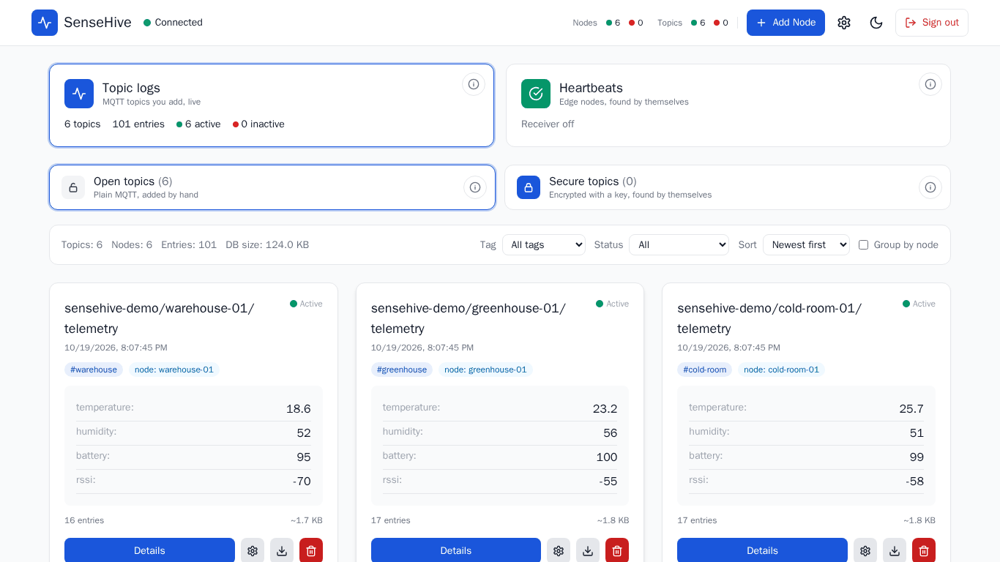
  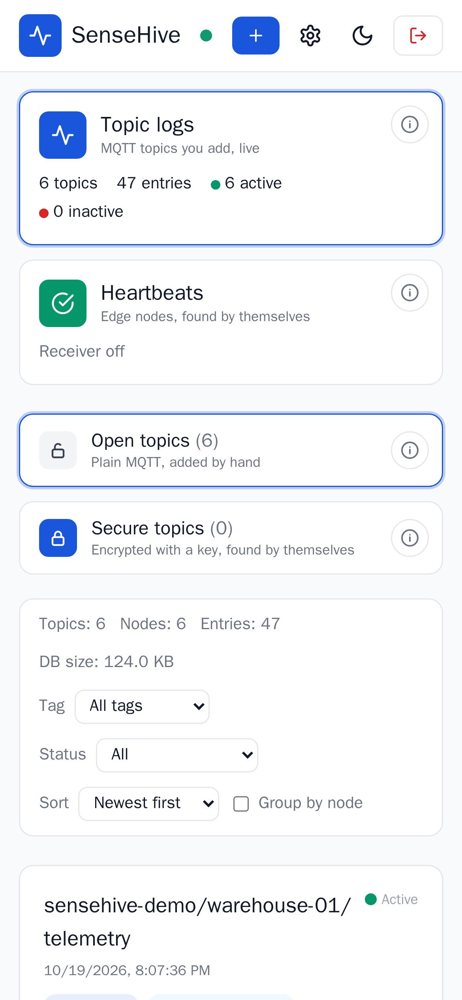
</p>

A real `pip install sensehive-iot` from PyPI with the emulated fleet running: a card per device,
live readings, **Active** from each device's last will; stop the fleet and they turn **Inactive**.

### 2. Home Assistant add-on

[](https://my.home-assistant.io/redirect/supervisor_add_addon_repository/?repository_url=https%3A%2F%2Fgithub.com%2F855princekumar%2Fsensehive-ha-addon)

1. **Add the repository**: the button, or **Settings, Apps, Install app** (older Home Assistant: **Settings, Add-ons, Add-on Store**), the menu,
   **Repositories**: `https://github.com/855princekumar/sensehive-ha-addon`
2. **Install** SenseHive, then **Start**
3. Turn on **Show in sidebar**
4. Open **SenseHive** from the sidebar: no second sign-in, and the Mosquitto broker add-on is found by itself

<p align="center">
  
  
</p>

A real Home Assistant (Supervisor and Core) with the Mosquitto add-on and an emulated fleet.
amd64 and aarch64 (Raspberry Pi 4/5), data in Home Assistant backups, AppArmor, security rating
8/8. Options, heartbeats, secure topics: [the add-on documentation](https://github.com/855princekumar/sensehive-ha-addon/blob/main/sensehive/DOCS.md).

### 3. Docker

One image for x86 and 64-bit Raspberry Pi (amd64 and arm64), 55 MB:

```bash
docker run -d --name sensehive --restart unless-stopped -p 5000:5000 \
  -v sensehive-data:/app/data -e SENSEHIVE_ADMIN_PASSWORD='choose-a-strong-password' \
  devprincekumar/sense-hive:1.8
```

Set the broker in **Settings**, or add `-e DEFAULT_BROKER_HOST=192.168.1.10 -e SENSEHIVE_FORCE_BROKER=true`.
The emulated fleet is in the image too:

```bash
docker exec sensehive python demo_fleet.py --broker 192.168.1.10 \
  --register http://127.0.0.1:5000 --password 'choose-a-strong-password'
```

`:1.8` follows the 1.8 releases; pin one (`:1.8.2`) to update only when you choose. Docker Compose,
volumes and all variables: [Deployment](#deployment) and [Configuration](docs/CONFIGURATION.md).

### 4. Native install

From source, for development or a machine without Docker:

```bash
git clone https://github.com/855princekumar/sense-hive
cd sense-hive/version-1.0
pip install -r requirements.txt
python app.py                                   # http://localhost:5000
```

To start at boot (Linux), run the pip package as a systemd service: the unit file is in
[docs/QUICKSTART.md](docs/QUICKSTART.md#2-pip).

---

## Your first topic

**Add Node** (top right): the MQTT topic (wildcards work: `sensors/#`, `home/+/temp`), a node id
(the device), a tag, and optionally the device's last-will topic for its online and offline status.

<p align="center">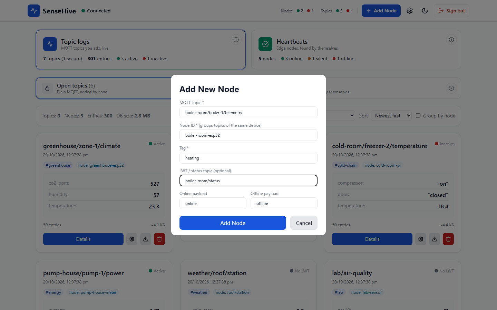</p>

Then publish from anywhere; JSON is shown field by field, anything else as text:

```bash
mosquitto_pub -h localhost -t greenhouse/zone-1/climate -m '{"temperature": 23.4, "humidity": 61}'
mosquitto_pub -h localhost -t greenhouse/status -m online -r       # the device's last-will topic
```

Python and ESP32 examples: [docs/QUICKSTART.md](docs/QUICKSTART.md#4-your-own-devices).

### Public brokers for a quick try

You can switch brokers anytime:

* `broker.hivemq.com` (default)
* `test.mosquitto.org`
* `broker.emqx.io`

| Broker             | Host                 | Port | Notes                   |
| ------------------ | -------------------- | ---- | ----------------------- |
| Eclipse Mosquitto  | `test.mosquitto.org` | 1883 | Very popular, stable    |
| EMQX Public Broker | `broker.emqx.io`     | 1883 | Good global performance |
| HiveMQ EU          | `broker.hivemq.com`  | 1883 | Default used            |

Example:

```bash
mosquitto_pub -h test.mosquitto.org -t test/topic -m "hello again"
```
---

#### Tip
Use a unique topic if testing on public brokers:
```
yourname/test/topic1
```
You can also use the included test script for automated data simulation if needed.

### Not seeing data?

* Topic must match exactly
* Use a unique topic (shared brokers)
* Check host/port (1883)
* Wait a few seconds

---

## Screenshots

Taken from a real SenseHive in a browser by `tools/screenshots.py` (an example site, made-up
data), so they always show the current release; CI takes them on every change.

<p align="center">
  
  
</p>
<p align="center">
  
  
</p>
<p align="center">
  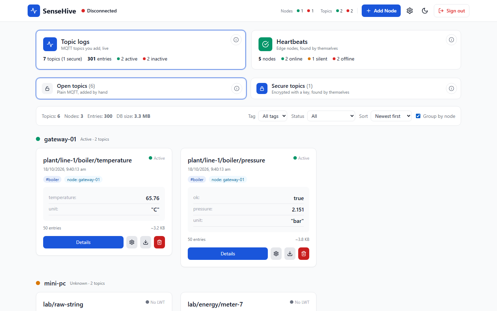
  
</p>
<p align="center">
  
  
</p>
<p align="center">
  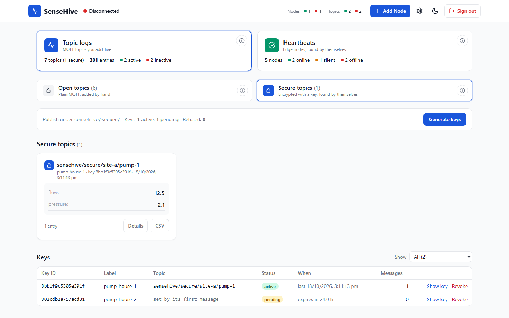
</p>
<p align="center">
  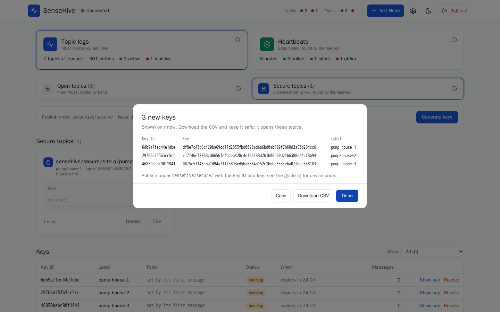
  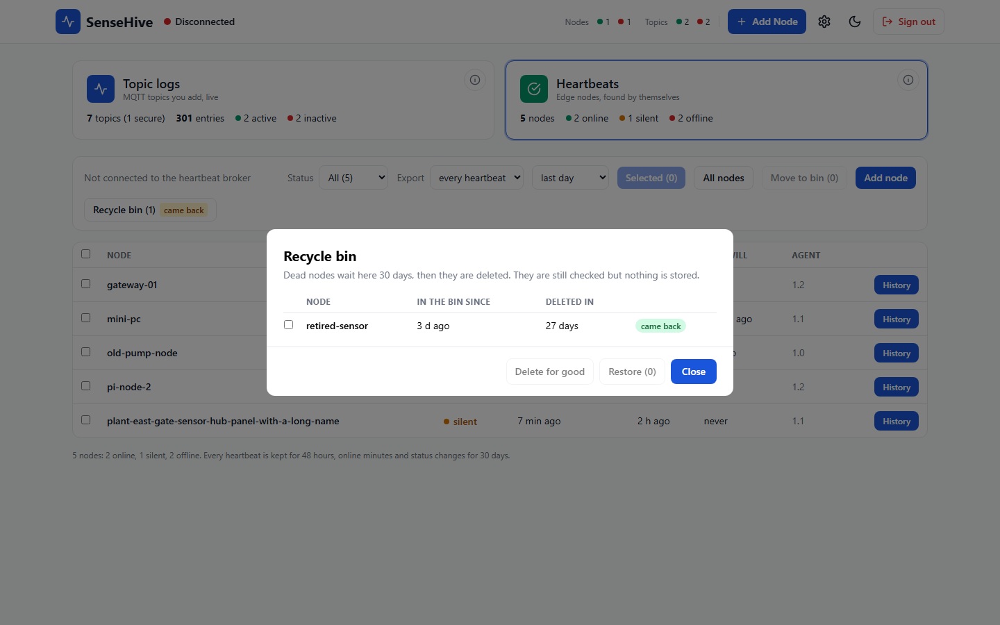
</p>
<p align="center">
  
  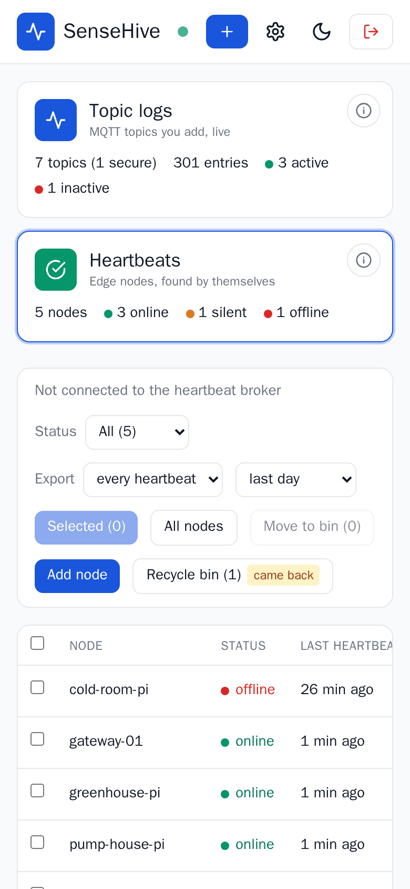
</p>

---

## Performance

**Under 40 MB of memory with 500 edge nodes and 100 busy topics, in a 55 MB image.** SenseHive
1.8.1 in Docker with a load generator: 500 nodes sending encrypted heartbeats (50 verified
messages a second), then also 100 topics logging 50 messages a second; median of 5-second samples
(script in `tools/measure/`, full results in [docs/PERFORMANCE.md](docs/PERFORMANCE.md)):

| Load | CPU (one core) | Memory |
| ---- | -------------- | ------ |
| Idle, broker connected, 100 topics subscribed | 0.03 % | 34.5 MB |
| 500 heartbeat nodes, 50 messages/s decrypted and verified | 10.2 % | 36.0 MB |
| The same plus 100 topics logging 50 messages/s | 26.6 % | 37.4 MB |

| Also measured | Value |
| ------------- | ----- |
| API with 500 nodes and 100 topics | 4 to 16 ms p50, under 20 ms p95 |
| Heartbeats refused in the run | 0 (all 500 nodes online) |
| Storage | about 370 bytes a logged message, indexes included |
| Docker image | 55 MB, amd64 and arm64 |

Intel Core i7-1185G7 laptop, Docker Desktop. Expect a few times the CPU share on a Raspberry Pi
core; memory stays about the same.

---


## Star History

<a href="https://www.star-history.com/?repos=855princekumar/sense-hive&type=date&legend=top-left">
  <picture>
    <source media="(prefers-color-scheme: dark)" srcset="https://api.star-history.com/chart?repos=855princekumar/sense-hive&type=date&theme=dark&legend=top-left" />
    <source media="(prefers-color-scheme: light)" srcset="https://api.star-history.com/chart?repos=855princekumar/sense-hive&type=date&legend=top-left" />
    
  </picture>
</a>

---

## Index

- [Documentation](#documentation)
- [The SenseHive Family](#the-sensehive-family)
- [Quick start](#quick-start)
- [Your first topic](#your-first-topic)
- [Screenshots](#screenshots)
- [Performance](#performance)
- [Minimum System Requirements](#minimum-system-requirements)
- [What's New in v1.8](#whats-new-in-v18)
- [What's New in v1.7](#whats-new-in-v17)
- [What's New in v1.6](#whats-new-in-v16)
- [What's New in v1.5](#whats-new-in-v15)
- [What's New in v1.4](#whats-new-in-v14)
- [Key Features](#key-features)
- [What's New in v1.1](#whats-new-in-v11)
- [Heartbeat receiver (v1.2)](#heartbeat-receiver-v12)
- [Overview](#overview)
- [Example Use Cases](#example-use-cases)
- [Why SenseHive Was Built](#why-sensehive-was-built)
- [Design Principles](#design-principles)
- [System Architecture](#system-architecture)
- [Data Flow](#data-flow)
- [Folder Structure](#folder-structure)
- [Deployment](#deployment)
- [Home Assistant Add-on (HAOS)](#home-assistant-add-on-haos)
- [Default Access](#default-access)
- [Data Persistence](#data-persistence)
- [Configuration](#configuration)
- [Test Setup (Quick Validation)](#test-setup-quick-validation)
- [Example Payload](#example-payload)
- [Testing and CI/CD](#testing-and-cicd)
- [Comparison with Existing Solutions](#comparison-with-existing-solutions)
- [Positioning](#positioning)
- [When to Use SenseHive](#when-to-use-sensehive)
- [When NOT to Use SenseHive](#when-not-to-use-sensehive)
- [Current Limitations](#current-limitations)
- [Versioning and Release Status](#versioning-and-release-status)
- [Stability Statement](#stability-statement)
- [Community Release](#community-release)
- [License](#license)
- [Closing Note](#closing-note)
- [Support & Feedback](#support--feedback)

---

## Documentation

Full guides live in [`docs/`](docs/README.md):
[Setup](docs/SETUP.md) |
[Configuration](docs/CONFIGURATION.md) |
[Using SenseHive](docs/USING.md) |
[Secure topics](docs/SECURE-TOPICS.md) |
[Heartbeats and EdgeShell](docs/HEARTBEAT.md) |
[Validate without hardware](docs/VALIDATE-WITHOUT-HARDWARE.md) |
[Security](docs/SECURITY.md) |
[Development and testing](docs/DEVELOPMENT.md) |
[Architecture decisions](docs/adr/README.md) |
[Changelog](CHANGELOG.md)

---

## The SenseHive Family

SenseHive is the hub. Two device projects feed it, each found by SenseHive
by itself, with nothing to add per device:

| Project | Runs on | What it gives SenseHive |
| ------- | ------- | ----------------------- |
| [**MQTT heartbeat agent**](https://github.com/855princekumar/mqtt-heartbeat-service) | Linux edge nodes: Raspberry Pi, gateways, servers | Encrypted heartbeats every 10 s and a last will: each node **online, offline or silent**, with uptime history. **Add node** in SenseHive gives a join token; on the node `git clone` the agent and `sudo python3 setup.py` ([Heartbeats](docs/HEARTBEAT.md#adding-a-node-without-edgeshell)) |
| [**PowerPulse**](https://github.com/855princekumar/powerpulse) | ESP32 boards | A power presence beacon: flash it, plug it in, and it appears under **Secure topics** with its data, **online**, and **offline the moment power is lost** (or a plain build added by hand) ([Secure topics](docs/SECURE-TOPICS.md)) |
| [EdgeShell](https://github.com/855princekumar/edgeshell) | Your server | Fleet manager that shows SenseHive's heartbeat state on its node cards |
| [Home Assistant add-on](https://github.com/855princekumar/sensehive-ha-addon) | Home Assistant OS | SenseHive in the Home Assistant sidebar |

Every SenseHive change is tested against both device projects, **without
hardware**: the real PowerPulse firmware runs on a simulated ESP32 and must be
found, decrypted, shown online and then offline. How it works, the measured
numbers, and how to run the same checks yourself before you deploy hardware:
[Validate without hardware](docs/VALIDATE-WITHOUT-HARDWARE.md).

<p align="center">
  
</p>
<p align="center">
  
</p>

---

## Key Features

SenseHive collects data in two ways, side by side: the **MQTT logger** for the
topics you add, and the **heartbeat receiver**, which finds edge nodes by
itself and serves their state through a read-only API.

<p align="center">
  
</p>

| Category                   | Highlights                                                                         |
| -------------------------- | ---------------------------------------------------------------------------------- |
| **MQTT Data Ingestion**    | Compatible with any MQTT device · Public broker support · Topic-based subscription |
| **Dynamic Data Storage**   | Auto topic-to-table mapping · SQLite persistence · Timestamped entries             |
| **Real-Time Dashboard**    | Live updates (SSE) · Latest 50 entries per topic · Topic-based visualization cards |
| **Data Export**            | CSV export per topic · Easy data extraction                                        |
| **Organization**           | Tags · Node ID grouping · Filter by tag · Sort by name, status, entries or size    |
| **Device Health (LWT)**    | Online/offline per topic and per node · Live counts in the navbar                  |
| **Data Management**        | Entry count & size per topic · Retention by age/entries · SQLite WAL mode          |
| **Wildcard Topics**        | `sensors/#` and `home/+/temp` subscriptions are logged                             |
| **Secure Topics**          | Encrypted, signed per topic, found by themselves · Keys with CSV, expiry, revoke   |
| **Deployment Flexibility** | Docker (multi-arch amd64 + arm64) · Home Assistant add-on · `pip install` CLI      |
---

## Minimum System Requirements

| | Minimum | Recommended |
| --- | --- | --- |
| CPU | 1 core, ARMv8 (64-bit, e.g. Raspberry Pi 3) or x86-64 | 2 cores |
| Memory | 128 MB free (SenseHive uses about 28 MB idle, 35 MB with 500 nodes and 100 busy topics) | 512 MB free |
| Disk | 200 MB (image 57 MB) plus your data | 1 GB or more; about 0.35 MB per heartbeat node per day, topic data as published |
| OS | Linux with Docker 20.10+, Home Assistant OS, or any OS with Python 3.9 to 3.13 | Linux with Docker |
| Network | A reachable MQTT broker (the public default needs internet) | Your own broker on the LAN |
| Clock | Correct time (NTP); secure topics and heartbeats refuse messages more than a few minutes off | |
| Browser | A current Chrome, Edge, Firefox or Safari, desktop or phone | |

Measured, not estimated: see [Performance](docs/PERFORMANCE.md).

---

## What's New in v1.8

| Area | Change |
| ---- | ------ |
| Many nodes | **Add node, Many nodes (CSV)**: up to 500 tokens at a time; the agent's bulk tool sets them all up over SSH with the broker login, tests each node and rolls new passwords out ([guide](docs/HEARTBEAT.md#many-nodes-a-csv-of-tokens-and-the-bulk-tool)) |
| Add node | **Heartbeats, Add node**: a join token for a new node. On the node: `git clone` the [heartbeat agent](https://github.com/855princekumar/mqtt-heartbeat-service), `sudo python3 setup.py`, paste the token. A hardened systemd service, and the node appears by itself. No EdgeShell, and SenseHive never connects to the node ([guide](docs/HEARTBEAT.md#adding-a-node-without-edgeshell)) |
| Isolation | `HEARTBEAT_MASTER_KEY=auto`: every SenseHive its own fleet. Other people's nodes on the same public broker never appear, and yours never appear in theirs ([how](docs/HEARTBEAT.md#every-sensehive-is-its-own-fleet)) |
| Without hardware | The real PowerPulse firmware on a simulated ESP32 and the agent on a systemd node, tested on every change, with the measured numbers ([Validate without hardware](docs/VALIDATE-WITHOUT-HARDWARE.md)) |

<p align="center">
  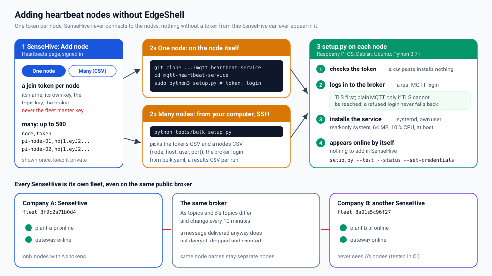
</p>
<p align="center">
  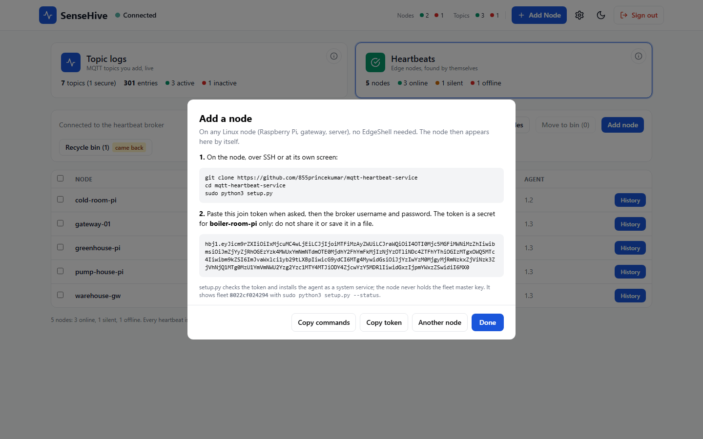
</p>

---

## What's New in v1.7

| Area | Change |
| ---- | ------ |
| Secure topics | Encrypted and signed per topic with keys SenseHive issues. Flash a device with a key, it publishes under `sensehive/secure/...`, and its topic **appears by itself**; nobody without the key can read, change or replay its data, even on a public broker. [Guide, device code and protocol](docs/SECURE-TOPICS.md) |
| Keys | Generate 1 to 100 at a time with a label, shown once, **CSV download**; bound to their topic on first use; unused keys expire after 24 hours; show again with your password; revoke |
| Open and secure | Topic logs has two cards, **Open topics** (added by hand) and **Secure topics** (found by themselves), each with an (i) guide |
| Devices | Tested code for Python, MicroPython, Node.js and Node-RED, ESP32 (Arduino) |
| Recycle bin | Move retired heartbeat nodes out of the list; restore them, delete them for good, or see when one comes back |

<p align="center">
  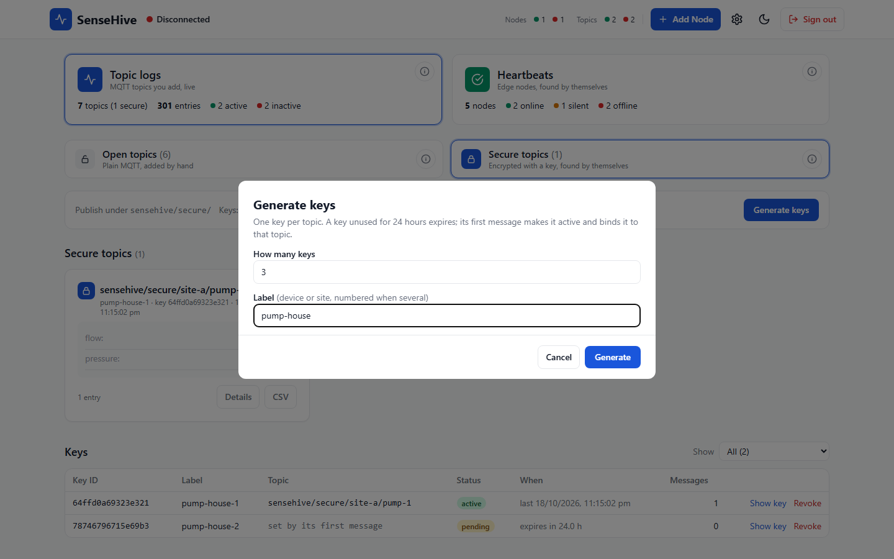
  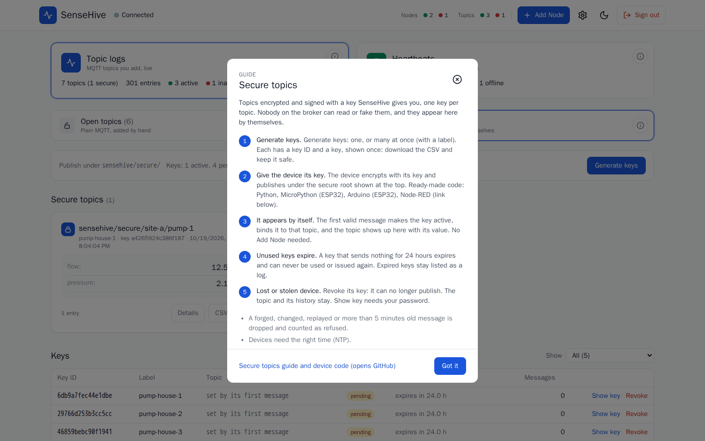
</p>

---

## What's New in v1.6

| Area | Change |
| ---- | ------ |
| Guides | An **(i)** button on the Topic logs and Heartbeats cards opens a short guide: what the view is for and how to use it, step by step; the heartbeat guide links to the [agent's repository](https://github.com/855princekumar/mqtt-heartbeat-service) |
| Filters | Filter by status: topics by online, offline or no last will; heartbeat nodes by online, offline or silent, with counts |
| Deployment | [Deploying securely](docs/SECURITY.md#deploying-securely): one domain on 443 through a TLS proxy, SenseHive's port on loopback only, DNS, firewall and checks from outside |

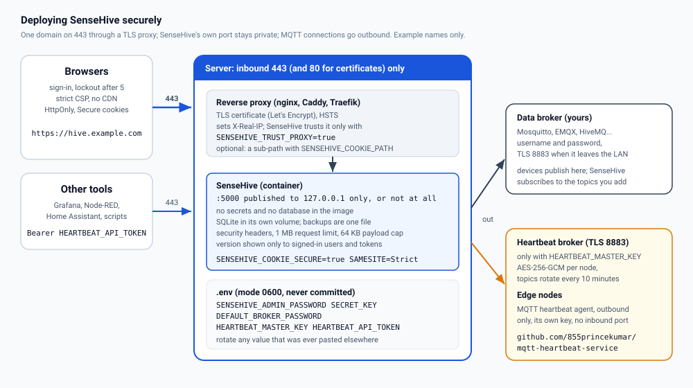

---

## What's New in v1.5

| Area | Change |
| ---- | ------ |
| Heartbeat history | Every heartbeat kept (48 h by default); per-node charts for 1 minute, 1 hour, 1 day, 7 days and 30 days with breaks, uptime and delivery delay; CSV export for one, selected or all nodes |
| Dashboard | Two cards, Topic logs and Heartbeats, switch the view with a smooth fade (GPU-composited, respects reduced motion); every dialog fits the screen at any size and zoom |
| Security | Strict hostile-input review ([ADR 0008](docs/adr/0008-hostile-input.md)): payload size cap, per-node flood limit, API token lockout, CSV formula escaping, request size limit, more security headers, CI actions pinned to commits |

<p align="center">
  
  
</p>

---

## What's New in v1.4

| Area | Change |
| ---- | ------ |
| Look | EdgeShell's theme (colours, font, sign-in card, top bar), light by default, dark remembered and shared with the heartbeats page |
| Layout | Fits phones, tablets and desktops at 67 to 200 % zoom: top bar wraps into icon buttons, cards and dialogs never overflow, Escape closes dialogs |
| Security | No CDN: browser code built ahead of time and served by SenseHive under a strict Content Security Policy; topics that could break SQL are refused and table names are always safely quoted; no default password on the sign-in page |
| Quality | Browser UI test (about 145 checks, every screen size and zoom, light and dark), ruff, Bandit and pip-audit in CI, front-end build check |
| Docs | Full guides in [`docs/`](docs/README.md) with architecture decision records |

See the [Changelog](CHANGELOG.md).

---

## What's New in v1.1

| Area | Change | Issue |
| ---- | ------ | ----- |
| UI | JSON arrays, nested objects and long values wrap inside the cards (Chrome and Firefox) | [#3](https://github.com/855princekumar/sense-hive/issues/3) |
| Performance | SQLite WAL mode; data retention by age and/or max entries per topic | [#1](https://github.com/855princekumar/sense-hive/issues/1) |
| Dashboard | Entry count and size per topic, mandatory tags and Node ID, filter/sort/group, LWT online/offline status with navbar counts | [#5](https://github.com/855princekumar/sense-hive/issues/5) |
| Install | `pip install sensehive-iot` with a `sensehive` CLI | [#4](https://github.com/855princekumar/sense-hive/issues/4) |
| Home Assistant | One-click HAOS add-on with ingress, Mosquitto auto-discovery and backups | [#2](https://github.com/855princekumar/sense-hive/issues/2) |
| Reliability | Wildcard topics logged, live updates reach every open tab, paho-mqtt 2.x support, no dev data in the image, persistent session secret | |
| Quality | 73-test regression suite, CI on every PR, automated multi-arch image publishing | |

Existing v1.0 databases are migrated automatically on first start. Keep your `/app/data` volume.

---

## Heartbeat receiver (v1.2)

SenseHive can receive **encrypted, authenticated heartbeats** from edge nodes
running the [MQTT heartbeat agent](https://github.com/855princekumar/mqtt-heartbeat-service),
over a public broker, and serve their state read-only to
[EdgeShell](https://github.com/855princekumar/edgeshell) (VPN-independent
uptime and LWT status on its node cards) or **any other tool** that reads JSON
(Grafana, Node-RED, Home Assistant, scripts).

<p align="center">
  
</p>

- **Nothing to set up per node.** Give SenseHive the fleet's master key and it
  computes the fleet's rotating topics itself, derives each sender's key from
  the key id in the message, and records a node on its **first valid
  heartbeat**. There is no node list to maintain and no topic to add.
- **The agent** for the nodes lives in its own repository,
  [mqtt-heartbeat-service](https://github.com/855princekumar/mqtt-heartbeat-service),
  with its architecture, lifecycle and a setup guide
  ([docs/SETUP.md](https://github.com/855princekumar/mqtt-heartbeat-service/blob/main/docs/SETUP.md)).
- **The MQTT logger keeps working as before**: add topics with **Add Node** and
  watch them on the dashboard; the receiver uses its own connection and tables.

The full guide, with how the agent works on a node, example API responses and
recipes for curl, Python, Node-RED, Home Assistant and Grafana, is in
[docs/HEARTBEAT.md](docs/HEARTBEAT.md).

- **Off by default.** Set `HEARTBEAT_MASTER_KEY` (64 hex characters) to turn it
  on. Nothing else in SenseHive changes: it uses its own TLS connection to the
  heartbeat broker and its own tables.
- **Verified, not trusted.** Every message is AES-256-GCM encrypted and
  authenticated with the sending node's own key, on topics that change every
  ten minutes. Messages from strangers on the broker, replays and messages
  sealed with another key are dropped (and counted).
- **State per node:** `online` (heartbeats arriving), `offline` (its last will
  arrived), `silent` (no heartbeat and no will: usually the broker or internet
  path). Changes are kept as events; per-minute presence is kept for
  `HEARTBEAT_KEEP_DAYS` (30) for uptime calculations.
- **Page:** `/heartbeats` (signed in) lists every node.
- **Read-only API** (`GET` only), with `Authorization: Bearer <HEARTBEAT_API_TOKEN>`
  or a signed-in session:

| Endpoint | Returns |
| -------- | ------- |
| `/api/heartbeat/status` | receiver on, broker connected, nodes seen, rejected messages |
| `/api/heartbeat/nodes` | per node: status, last heartbeat, since, last will time, agent version |
| `/api/heartbeat/minutes?since=<unix>` | per node, the minutes with a verified heartbeat |
| `/api/heartbeat/events?since=<unix>` | status changes, oldest first |

| Variable | Default | Purpose |
| -------- | ------- | ------- |
| `HEARTBEAT_MASTER_KEY` | empty (off) | Fleet master key, 64 hex characters (secret) |
| `HEARTBEAT_API_TOKEN` | empty | Bearer token for the API, at least 32 characters (secret) |
| `HEARTBEAT_BROKER` / `HEARTBEAT_PORT` / `HEARTBEAT_TLS` | `broker.hivemq.com` / `8883` / `true` | Heartbeat broker (TLS, certificate verified) |
| `HEARTBEAT_STALE_SECONDS` | `35` | No heartbeat for this long: `silent` |
| `HEARTBEAT_KEEP_DAYS` | `30` | Per-minute presence and events kept for |

Keep both secrets out of compose files you commit: use an `.env` file next to
`docker-compose.yml`.

---

## Overview

SenseHive is a self-hosted MQTT data ingestion and visualization system designed for **rapid deployment, minimal overhead, and reliable local operation**.

It enables engineers and teams to:

* Ingest MQTT data streams
* Persist data locally
* Visualize real-time telemetry
* Export structured datasets

The system is optimized for **edge environments, internal infrastructure, and low-resource devices**, where traditional IoT platforms are unnecessarily complex or resource-intensive.

## Example Use Cases

- Monitoring environmental sensors (temperature, humidity, AQI)
- Collecting telemetry from distributed IoT nodes
- Rapid prototyping of MQTT-based systems
- Internal dashboards for lab or field deployments
  
---

## Why SenseHive Was Built

In practical IoT deployments involving weather monitoring systems, DAQ nodes, and distributed sensor networks, existing solutions were evaluated but did not meet the need for:

* Fast setup
* Lightweight execution
* Direct data visibility

Most available tools required:

* Complex configuration
* Multiple dependent services
* Higher system resources

The requirement was clear:

> A simple, plug-and-play system that can be deployed instantly and start logging MQTT data without setup overhead.

SenseHive was built to meet that need.

The experience aimed to replicate the simplicity of tools that offer immediate usability with minimal configuration - but for MQTT-based data systems.

---

## Design Principles

* Simplicity over complexity
* Edge-first deployment
* Minimal dependencies
* One-command startup
* Reliable local operation

---

## System Architecture

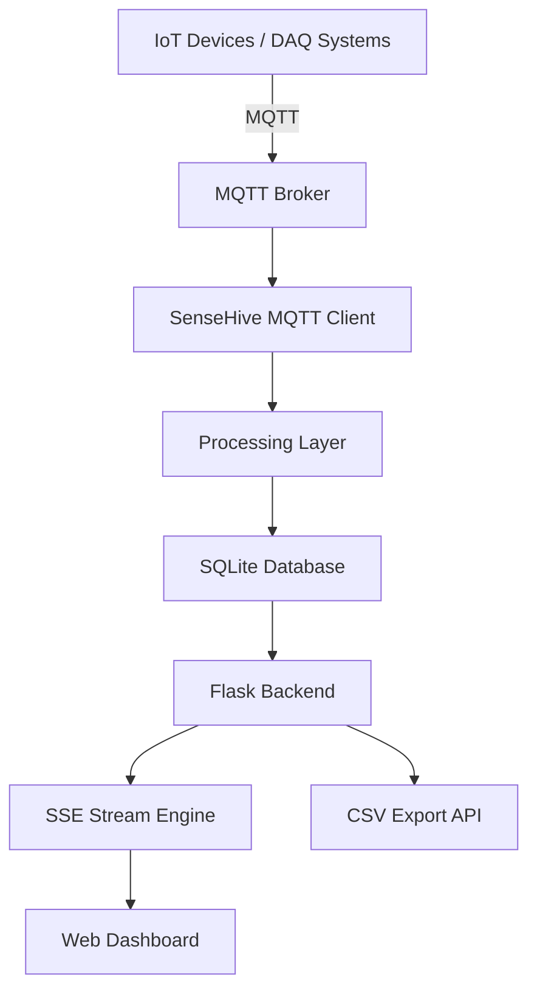

### As part of the EdgeShell system

SenseHive also runs next to [EdgeShell](https://github.com/855princekumar/edgeshell),
the fleet control plane, as its **heartbeat receiver**. Five projects work
together:

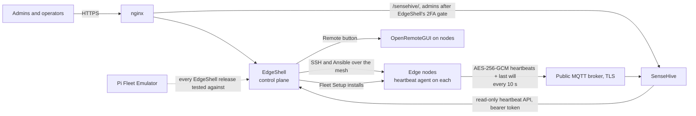

| Part | Job |
| ---- | --- |
| [EdgeShell](https://github.com/855princekumar/edgeshell) | Users, roles, 2FA, SSH and Ansible to nodes, monitoring, uptime and SLA |
| **SenseHive** | Verifies node heartbeats and serves their state to EdgeShell; MQTT data logger for admins |
| [MQTT heartbeat agent](https://github.com/855princekumar/mqtt-heartbeat-service) | On every node: encrypted heartbeat every 10 s and a last will |
| [OpenRemoteGUI](https://github.com/855princekumar/OpenRemoteGUI) | Browser remote desktop on nodes |
| [Pi Fleet Emulator](https://github.com/855princekumar/pi-fleet-emulator) | Emulated Pi fleet for testing |

**Recommended setup:** run SenseHive from EdgeShell's Compose file (it is
already in it), give both the same `HEARTBEAT_MASTER_KEY` and API token, install
the agent from EdgeShell's **Fleet Setup**, and open SenseHive from EdgeShell's
admin panel. Node status then arrives on two independent paths: SSH metrics
over the mesh, and heartbeats over the broker, so a VPN outage is told apart
from a node outage. Details: [docs/HEARTBEAT.md](docs/HEARTBEAT.md).

---

## Data Flow

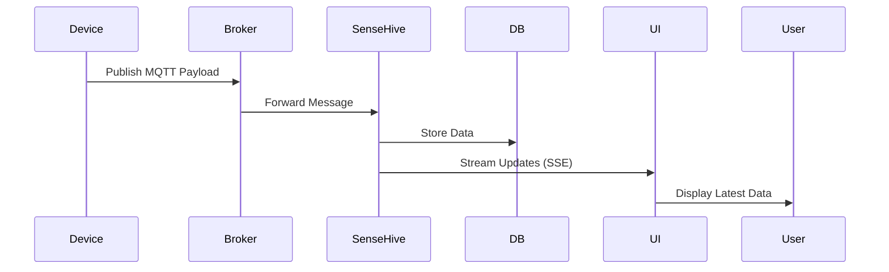
---

## Folder Structure

```
.
├── version-1.0/              # application (also the `sensehive` pip package)
│   ├── app.py                # Flask app + MQTT logger
│   ├── cli.py                # `sensehive` command
│   ├── heartbeat.py          # heartbeat receiver + read-only API
│   ├── security.py           # sign-in hardening
│   ├── templates/            # dashboard, login and heartbeats pages
│   ├── static/               # built browser code (committed, no CDN)
│   ├── requirements.txt
│   └── Dockerfile
├── frontend/                 # browser sources (JSX, CSS), built by `npm run build`
├── tools/                    # front-end build, browser UI test, screenshots
├── tests/                    # regression suite (pytest) + legacy DB fixture
├── docs/                     # guides and architecture decision records
├── .github/workflows/        # CI (every PR) and CD (Docker Hub, PyPI, releases)
├── Docker-compose/           # compose files for x86 and ARM
├── Test-sensehive/           # test publisher script
├── pyproject.toml            # pip packaging (sensehive-iot)
├── DOCKERHUB.md              # Docker Hub description (synced by CD)
├── README.md
└── LICENSE
```

The Home Assistant add-on lives in its own repository:
[855princekumar/sensehive-ha-addon](https://github.com/855princekumar/sensehive-ha-addon).

---

## Deployment

### Option 1: Docker (Recommended)

#### Pull Images

```bash
docker pull devprincekumar/sense-hive:latest
```

* One multi-arch image for AMD64 / x86 and ARM64 (Raspberry Pi 4/5); Docker picks the right one
* Pin a release with `devprincekumar/sense-hive:1.8.2`; `edge` tracks the `main` branch
* `arm-pi-5` remains available and points to the same multi-arch release

---

#### Run Container

```bash
docker run -d \
  -p 5000:5000 \
  -v $(pwd)/data:/app/data \
  devprincekumar/sense-hive:latest
```

---

### Option 2: Docker Compose

Use the provided compose files:

* `docker-compose-amd.yml`
* `docker-compose-arm.yml`

---

### Option 3: Local Run (Without Docker)

```bash
cd version-1.0
python app.py
```

Access the dashboard:

```
http://localhost:5000
```

---

### Option 4: pip install (CLI)

```bash
pip install sensehive-iot
sensehive --port 5000 --broker localhost     # your broker; open http://localhost:5000 (admin / admin123)
```

No devices yet? `sensehive-demo` (installed with the package) is a small emulated fleet: each
device has its own last will and publishes JSON readings. `--register` adds them as nodes for you:

```bash
sensehive-demo --broker localhost --register http://localhost:5000 --password admin123
```

The dashboard fills in within seconds: a card per device with live readings, Active from its
last will, and Inactive when you stop it (Ctrl+C). CI runs exactly this on every change: the
built wheel in a clean venv, a real broker, the emulated fleet and a browser on phone, tablet,
laptop and desktop (25 checks), and the same against the Docker image.

Options:

```bash
sensehive --host 0.0.0.0 --port 5000 --broker broker.hivemq.com
sensehive --broker 192.168.1.10 --broker-port 1883 --broker-username user --broker-password pass
sensehive --timezone Asia/Kolkata --data-dir ~/sensehive-data
sensehive --version
```

Data is stored in `~/.sensehive` unless `--data-dir` (or `DB_PATH`) is set. `--broker` overrides
the broker saved in Settings. Install straight from GitHub with
`pip install git+https://github.com/855princekumar/sense-hive`.

---

## Home Assistant Add-on (HAOS)

One-click deployment for Home Assistant OS / Supervised users.

[](https://my.home-assistant.io/redirect/supervisor_add_addon_repository/?repository_url=https%3A%2F%2Fgithub.com%2F855princekumar%2Fsensehive-ha-addon)

1. **Settings → Apps → Install app → ⋮ → Repositories** (older Home Assistant: **Settings → Add-ons → Add-on Store**), add `https://github.com/855princekumar/sensehive-ha-addon`
2. Install **SenseHive**, press **Start**, enable **Show in sidebar**
3. Open **SenseHive** from the sidebar, add a topic and publish

| Feature | Details |
| ------- | ------- |
| Ingress | Opens in the Home Assistant sidebar; Home Assistant handles authentication |
| Zero MQTT setup | Connects to the Mosquitto broker add-on automatically (or set a broker in Configuration) |
| Backups | Database stored in the add-on `/data` folder, included in Home Assistant backups |
| Security | AppArmor profile, no privileges, direct port access disabled by default |
| Architectures | amd64 and aarch64 (Raspberry Pi 4/5) |

**Build, test and validation**

| Check | Result |
| ----- | ------ |
| Home Assistant app linter (official schema) | Passed |
| AppArmor profile parse (`apparmor_parser`) | Passed |
| Multi-arch image build (amd64 + aarch64) | Passed, built from `devprincekumar/sense-hive` (the add-on follows each SenseHive release) |
| Sandbox: mock Supervisor at 172.30.32.2 + Mosquitto with credentials + ingress proxy | 26/26 checks passed |
| Real Home Assistant: official apps devcontainer, Home Assistant 2026.10.2 + Supervisor 2026.10.3 (store install, Mosquitto discovery, ingress via Core, data flow, LWT, restart, backup) | 21/21 checks passed, in CI on every change |
| Real Home Assistant with a browser: Home Assistant's sign-in, SenseHive in the sidebar, the panel without a second sign-in, Add Node, an emulated fleet of 6 devices on Home Assistant's Mosquitto, live readings and last-will status, details, dark mode, phone to desktop with no layout or console errors | 30 checks passed, in CI on every change |
| Supervisor security rating | 8/8 (AppArmor profile, no API or host access, protected mode) |

The add-on repository runs the linter, AppArmor, build and sandbox checks on every change,
and a daily sync workflow opens a PR when a new SenseHive release is published.

---

### Alternative: Docker next to Home Assistant

SenseHive can also run as a plain container next to Home Assistant, connected to the same MQTT broker (e.g., Mosquitto add-on).

This setup is useful for:

- Inspecting raw MQTT topics  
- Logging data independently of Home Assistant  
- Exporting MQTT data for analysis  

---

### Quick Setup (Docker Compose)

#### Standard Systems (x86 / AMD64)

```yaml
version: "3.8"

services:
  sense-hive:
    image: devprincekumar/sense-hive:latest
    container_name: sense-hive
    ports:
      - "5500:5000"
    volumes:
      - ./sensehive-data:/app/data
    restart: unless-stopped
    networks:
      - sense-hive-network
    healthcheck:
      test: ["CMD", "python", "-c", "import urllib.request; urllib.request.urlopen('http://localhost:5000/api/status')"]
      interval: 30s
      timeout: 10s
      retries: 3
      start_period: 10s

networks:
  sense-hive-network:
    driver: bridge
```

Access SenseHive at: http://localhost:5500  

---

#### Raspberry Pi (ARM)

```yaml
version: "3.8"

services:
  sense-hive:
    image: devprincekumar/sense-hive:arm-pi-5
    container_name: sense-hive
    ports:
      - "5500:5000"
    volumes:
      - /config/sensehive:/app/data
    restart: unless-stopped
    networks:
      - sense-hive-network
    healthcheck:
      test: ["CMD", "python", "-c", "import urllib.request; urllib.request.urlopen('http://localhost:5000/api/status')"]
      interval: 30s
      timeout: 10s
      retries: 3
      start_period: 10s

networks:
  sense-hive-network:
    driver: bridge
```

Access SenseHive at: http://localhost:5500  

---

### Notes for Home Assistant Users

* Use the same MQTT broker configured in Home Assistant (typically Mosquitto)

* Broker host is usually:

  * `homeassistant.local`
  * or the Home Assistant IP (e.g., `192.168.1.x`)

* Default MQTT port: `1883`

* Use the same credentials defined in Home Assistant

---

### Data Persistence

* For standard Docker setups:

  * `./sensehive-data:/app/data`

* For Home Assistant environments:

  * `/config/sensehive:/app/data`

This ensures data persists across container restarts and aligns with Home Assistant storage conventions.

---

## Default Access

```
Username: admin
Password: SENSEHIVE_ADMIN_PASSWORD from the first start, otherwise admin123
```

Change `admin123` straight after the first sign-in. The sign-in page never shows
it, and five wrong passwords lock sign-in for 15 minutes.

---

## Data Persistence

Database location:

```
/app/data/iot_dashboard.db
```

| Install | Database location |
| ------- | ----------------- |
| Docker | `/app/data/iot_dashboard.db` (mount a volume) |
| Home Assistant add-on | `/data/iot_dashboard.db` (included in backups) |
| pip | `~/.sensehive/iot_dashboard.db` (or `--data-dir`) |

Note:

* Without volume mounting, data will not persist across container restarts
* SQLite runs in WAL mode; `-wal`/`-shm` files next to the database are normal

## Configuration

The default setup uses a public MQTT broker for quick testing.

You can modify:
- MQTT broker (local or remote)
- Credentials
- Timezone settings

Most settings live in the UI (**Settings**): broker, credentials, timezone, data retention and password.
Environment variables set the defaults for a new database:

| Variable | Default | Purpose |
| -------- | ------- | ------- |
| `DEFAULT_BROKER_HOST` / `DEFAULT_BROKER_PORT` | `broker.hivemq.com` / `1883` | Broker for a new database |
| `DEFAULT_BROKER_USERNAME` / `DEFAULT_BROKER_PASSWORD` | empty | Broker credentials |
| `SENSEHIVE_FORCE_BROKER` | `false` | `true` applies `DEFAULT_BROKER_*` on every start |
| `DEFAULT_TIMEZONE` | `UTC` | Timezone for a new database |
| `RETENTION_DAYS` / `RETENTION_MAX_ENTRIES` | `0` (off) | Initial retention policy |
| `RETENTION_INTERVAL` | `3600` | Seconds between retention runs |
| `SQLITE_WAL` | `true` | Set `false` on network filesystems (NFS/SMB) |
| `SECRET_KEY` | random, persisted next to the DB | Session secret |
| `DB_PATH` | `/app/data/iot_dashboard.db` | Database location |
| `HOST` / `PORT` | `0.0.0.0` / `5000` | Listen address for `python app.py` |
| `HEARTBEAT_*` | off | Heartbeat receiver, see [Heartbeat receiver](#heartbeat-receiver-v12) |
| `SENSEHIVE_SECURE_TOPICS` / `SENSEHIVE_SECURE_ROOT` | `true` / `sensehive/secure` | [Secure topics](docs/SECURE-TOPICS.md) on or off, and their root |
| `SENSEHIVE_ADMIN_PASSWORD` | empty (`admin123`) | First password of the `admin` user in a new database (never printed) |
| `SENSEHIVE_MAX_FAILED_LOGINS` / `SENSEHIVE_LOCK_MINUTES` | `5` / `15` | Sign-in is refused for a user or an address after this many failures in this window |
| `SENSEHIVE_TRUST_PROXY` | `false` | Behind a reverse proxy: take the client address from `X-Real-IP` (limits per real client) |
| `SENSEHIVE_COOKIE_SECURE` / `_SAMESITE` / `_PATH` | `false` / `Lax` / `/` | Session cookie flags (always HttpOnly); behind HTTPS use `true` / `Strict` |
| `SENSEHIVE_SESSION_HOURS` | `12` | Session lifetime |

---

## Test Setup (Quick Validation)

A test publisher is included to simulate IoT data.

### Step 1: Start SenseHive

Run using Docker or local execution.

---

### Step 2: Run Test Script

```bash
cd test-sensehive
python test_script.py
```

---

### Step 3: Configure Dashboard

* Add topic: `test-sensehive`
* Observe live updates
* View latest 50 entries
* Export data using CSV

---

## Example Payload

```json
{
  "device_id": "sensehive_node_01",
  "timestamp": 1710000000,
  "temperature": 28.5,
  "humidity": 62,
  "status": "active"
}
```

---

## Testing and CI/CD

Run the suites locally (details in [Development and testing](docs/DEVELOPMENT.md)):

```bash
pip install -r version-1.0/requirements.txt pytest
python -m pytest                                        # unit + API tests
SENSEHIVE_TEST_BROKER=localhost:1883 python -m pytest   # plus end-to-end against a real broker
pip install playwright && python -m playwright install chromium
python tools/ui_test.py                                 # browser UI: every screen size and zoom
npm ci && npm run check                                 # built front end matches its sources
```

| Pipeline | Trigger | What runs |
| -------- | ------- | --------- |
| CI | Every pull request and push to `main` | Regression tests on Python 3.9 to 3.13 against a real Mosquitto broker, paho-mqtt 1.x compatibility, browser UI test (phone to desktop, 67 to 200 % zoom, CSP violations), ruff, Bandit, pip-audit, front-end build check, CodeQL, wheel build + CLI smoke test, Docker build + container health check |
| CD | Push to `main` | Full CI, then publishes `devprincekumar/sense-hive:edge` (amd64 + arm64) |
| CD | Tag `vX.Y.Z` | Full CI, then publishes `X.Y.Z`, `X.Y`, `latest`, `arm-pi-5`, updates the Docker Hub description, publishes `sensehive-iot` to PyPI and creates a GitHub release |

---

## Comparison with Existing Solutions

| Feature / Tool       | SenseHive           | ThingsBoard    | Node-RED        | Grafana + MQTT | Home Assistant |
| -------------------- | ------------------- | -------------- | --------------- | -------------- | -------------- |
| Setup Complexity     | Very Low            | High           | Medium          | High           | Medium         |
| One-Click Deployment | Yes                 | No             | Partial         | No             | Partial        |
| Resource Usage       | Low                 | High           | Medium          | High           | Medium         |
| MQTT Native Support  | Yes                 | Yes            | Yes             | Plugin-based   | Yes            |
| Built-in Storage     | Yes                 | Yes            | No              | No             | Yes            |
| Real-Time Dashboard  | Yes                 | Yes            | Limited         | Yes            | Yes            |
| Data Export          | Yes                 | Yes            | Custom          | Yes            | Limited        |
| Edge Device Friendly | Yes                 | Limited        | Yes             | Limited        | Limited        |
| Learning Curve       | Low                 | High           | Medium          | High           | Medium         |
| Intended Use Case    | Lightweight logging | Enterprise IoT | Flow automation | Observability  | Smart home     |

---

## Positioning

SenseHive is designed as:

> A lightweight, plug-and-play MQTT data logger and dashboard for quick deployment and internal use.

It is not intended to replace full-scale IoT platforms.

---

## When to Use SenseHive

- You need quick MQTT data logging without heavy setup  
- You are working with edge devices (ESP32, Raspberry Pi, DAQ systems)  
- You want a self-hosted, lightweight dashboard  
- You need fast prototyping or internal monitoring  

---

## When NOT to Use SenseHive

- You need large-scale distributed IoT infrastructure  
- You require multi-tenant SaaS architecture  
- You need advanced analytics or big data pipelines  
- You expect enterprise-grade scalability out of the box

---

## Current Limitations

* SQLite may not scale for high-throughput systems
* Table-per-topic schema limits scalability
* No dynamic schema optimization
* No built-in migration to time-series databases
* Basic authentication system
* No alerting or automation engine

---

## Versioning and Release Status

### v1.5 (Current)

* Heartbeat history with charts and CSV export, dashboard view cards, dialogs that always fit, hostile-input hardening ([What's New in v1.5](#whats-new-in-v15))

### v1.4

* EdgeShell's theme, responsive layout at every screen size and zoom, no CDN with a strict CSP, SQL-safe topic names, browser UI test, full docs and ADRs ([What's New in v1.4](#whats-new-in-v14))

### v1.3

* Sign-in hardening: salted, slow password hashes (old ones upgraded on the next sign-in), lockout after repeated failures per user and per address, a new session on every sign-in, cross-site requests that change data refused, HttpOnly cookies with configurable SameSite, Secure and Path, optional first admin password from the environment

### v1.2

* Heartbeat receiver: encrypted, authenticated heartbeats and LWT from edge nodes over a public broker, `/heartbeats` page, read-only API ([Heartbeat receiver](#heartbeat-receiver-v12))

### v1.1

* SQLite WAL mode and data retention
* Topic stats, tags, node grouping and LWT device status
* JSON payload wrapping fix, wildcard topic logging, multi-tab live updates
* pip package with CLI, Home Assistant add-on with ingress
* Regression suite and CI/CD; multi-arch Docker image

See [What's New in v1.1](#whats-new-in-v11).

---

### v1.0

* Stable and tested
* Running in internal LAN environments
* Used for real data aggregation across multiple devices
* Verified over more than two months of continuous usage

---

### Planned

* Alerts and notifications
* Advanced filters and tag analytics
* Node-level analytics
* Schema optimization groundwork

---

## Stability Statement

SenseHive is:

* Reliable for self-hosted and LAN-based deployments
* Suitable for continuous MQTT data logging
* Actively used in internal setups

However, it is still under development toward a fully scalable production-grade platform.

---

## Community Release

This project is being released as open source to:

* Enable wider testing
* Gather feedback from real-world use cases
* Improve scalability and feature set

Contributions, suggestions, and improvements are encouraged.

---

## License

MIT License

---

## Closing Note

SenseHive is built to simplify MQTT-based data logging and visualization without introducing unnecessary complexity.

It is particularly suited for:

* Edge deployments
* Rapid prototyping
* Internal monitoring systems
* Lightweight IoT infrastructures

The focus remains on usability, portability, and practical engineering needs.

---

## Support & Feedback

If you find this useful, consider starring the repository.

Feedback, issues, and contributions are welcome to help improve the project.
