<p align="center">
  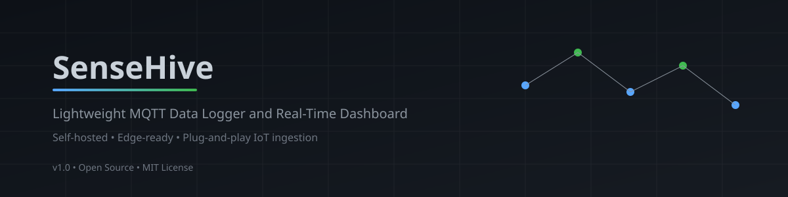
</p>

 [](https://github.com/855princekumar/sense-hive/actions/workflows/ci.yml)       [](https://github.com/855princekumar/sensehive-ha-addon) 

> Debug, log, and visualize your MQTT data instantly, like uptime-kuma, but built for MQTT and IoT data.

**Run → Add Topic → Publish → See Data in under 30 seconds.**

<p align="center">
<a href="https://sense-hive.855princekumar.workers.dev/" target="_blank">
  
</a>
</p>

## Star History

<a href="https://www.star-history.com/?repos=855princekumar/sense-hive&type=date&legend=top-left">
  <picture>
    <source media="(prefers-color-scheme: dark)" srcset="https://api.star-history.com/chart?repos=855princekumar/sense-hive&type=date&theme=dark&legend=top-left" />
    <source media="(prefers-color-scheme: light)" srcset="https://api.star-history.com/chart?repos=855princekumar/sense-hive&type=date&legend=top-left" />
    
  </picture>
</a>

---

## Index

- [Documentation](#documentation)
- [Quick Start (30 seconds)](#quick-start-30-seconds)
- [Dashboard Preview](#dashboard-preview)
- [What's New in v1.4](#whats-new-in-v14)
- [Key Features](#key-features)
- [What's New in v1.1](#whats-new-in-v11)
- [Heartbeat receiver (v1.2)](#heartbeat-receiver-v12)
- [Overview](#overview)
- [Example Use Cases](#example-use-cases)
- [Why SenseHive Was Built](#why-sensehive-was-built)
- [Design Principles](#design-principles)
- [System Architecture](#system-architecture)
- [Data Flow](#data-flow)
- [Folder Structure](#folder-structure)
- [Deployment](#deployment)
- [Home Assistant Add-on (HAOS)](#home-assistant-add-on-haos)
- [Default Access](#default-access)
- [Data Persistence](#data-persistence)
- [Configuration](#configuration)
- [Test Setup (Quick Validation)](#test-setup-quick-validation)
- [Example Payload](#example-payload)
- [Testing and CI/CD](#testing-and-cicd)
- [Performance Benchmarks](#performance-benchmarks)
- [Comparison with Existing Solutions](#comparison-with-existing-solutions)
- [Positioning](#positioning)
- [When to Use SenseHive](#when-to-use-sensehive)
- [When NOT to Use SenseHive](#when-not-to-use-sensehive)
- [Current Limitations](#current-limitations)
- [Versioning and Release Status](#versioning-and-release-status)
- [Stability Statement](#stability-statement)
- [Community Release](#community-release)
- [License](#license)
- [Closing Note](#closing-note)
- [Support & Feedback](#support--feedback)

---

## Documentation

Full guides live in [`docs/`](docs/README.md):
[Setup](docs/SETUP.md) |
[Configuration](docs/CONFIGURATION.md) |
[Using SenseHive](docs/USING.md) |
[Heartbeats and EdgeShell](docs/HEARTBEAT.md) |
[Security](docs/SECURITY.md) |
[Development and testing](docs/DEVELOPMENT.md) |
[Architecture decisions](docs/adr/README.md) |
[Changelog](CHANGELOG.md)

---

## Quick Start (30 seconds)

Get SenseHive running and visualize MQTT data instantly.

### 1. Run the Container

```bash
docker run -d -p 5000:5000 -v $(pwd)/sensehive-data:/app/data \
  -e SENSEHIVE_ADMIN_PASSWORD='choose-a-strong-password' devprincekumar/sense-hive:latest
```

Prefer no Docker? `pip install sensehive-iot && sensehive`. On Home Assistant OS? Install the [add-on](#home-assistant-add-on-haos).

---

### 2. Open the Dashboard

```
http://localhost:5000
```

Sign in as `admin` with the password you chose (or `admin123` if you did not set one, then change it at once in **Settings**).

---

### 3. Add Any MQTT Topic

* Click **“+ Add Node”**
* Enter a topic (example):

  ```
  test/topic
  ```
* Save

> Example Topics You Can Try
- home/livingroom/temp
- sensor/temperature
- test/topic

No setup required, just Subscribe and watch.

---

### 4. Publish Data (From Anywhere)

Publish a message using any MQTT client:

```bash
mosquitto_pub -h broker.hivemq.com -t test/topic -m "hello world"
```

That’s it, your data will appear **instantly** on the dashboard, no scripts, no setup.

> Run → Add Topic → Publish → See Data

---

### Try Other Public Brokers (Optional)

You can switch brokers anytime:

* `broker.hivemq.com` (default)
* `test.mosquitto.org`
* `broker.emqx.io`

| Broker             | Host                 | Port | Notes                   |
| ------------------ | -------------------- | ---- | ----------------------- |
| Eclipse Mosquitto  | `test.mosquitto.org` | 1883 | Very popular, stable    |
| EMQX Public Broker | `broker.emqx.io`     | 1883 | Good global performance |
| HiveMQ EU          | `broker.hivemq.com`  | 1883 | Default used            |

Example:

```bash
mosquitto_pub -h test.mosquitto.org -t test/topic -m "hello again"
```
---

### Tip
Use a unique topic if testing on public brokers:
```
yourname/test/topic1
```
You can also use the included test script for automated data simulation if needed.

### Not Seeing Data?

* Topic must match exactly
* Use a unique topic (shared brokers)
* Check host/port (1883)
* Wait a few seconds

---
## Dashboard Preview

Screenshots are taken from a seeded test install by `tools/screenshots.py`
(made-up topics, no real data), so they always show the current release.

<p align="center">
  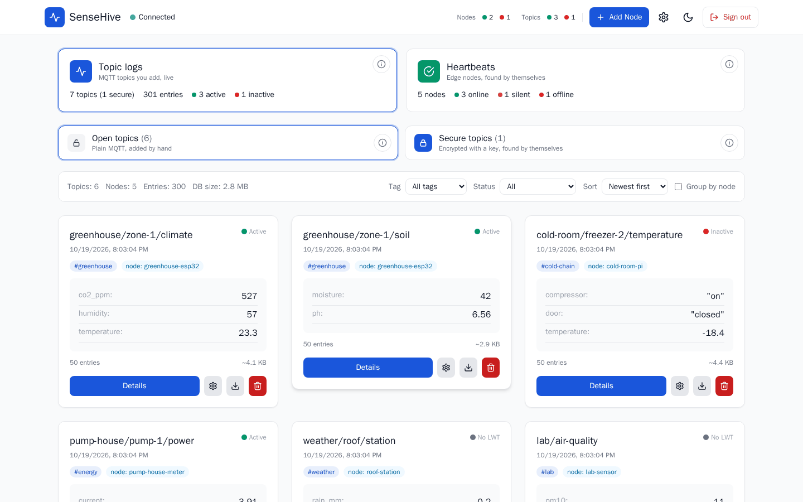
</p>
<p align="center">
  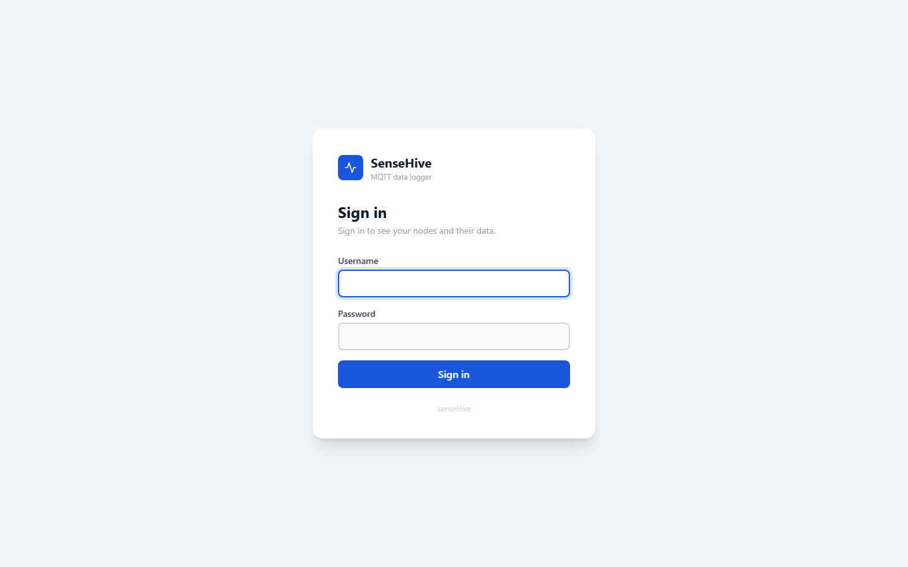
  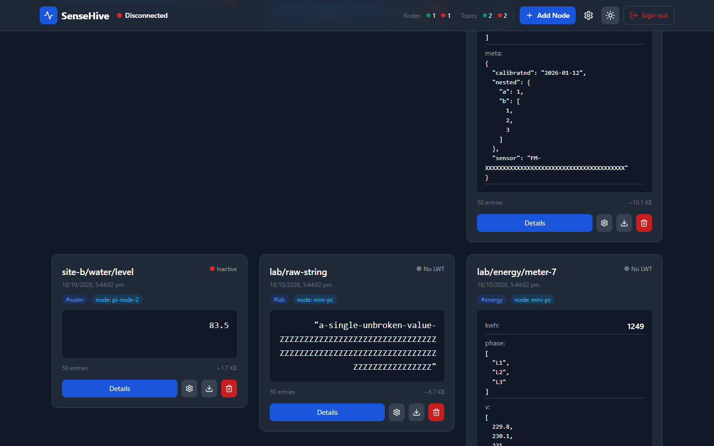
</p>
<p align="center">
  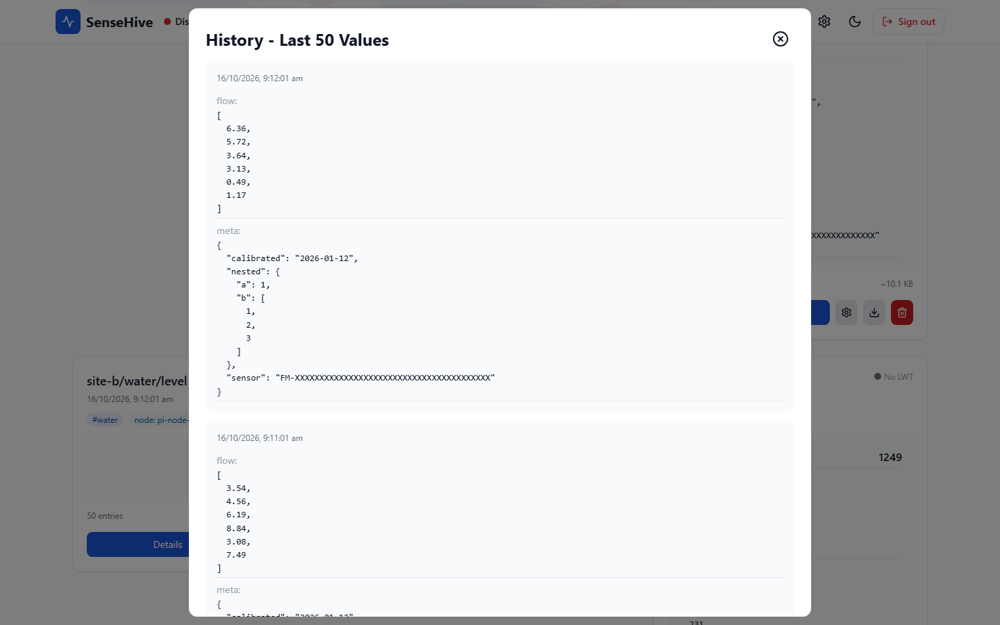
  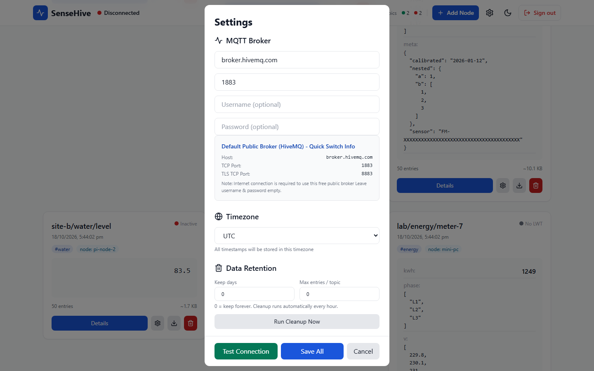
</p>
<p align="center">
  
  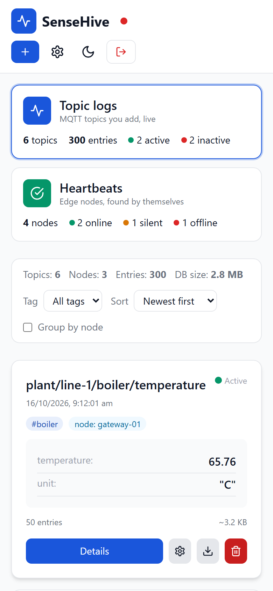
</p>
<p align="center">
  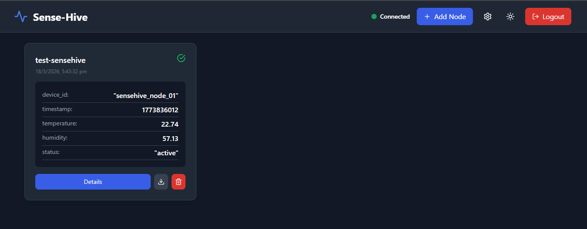
</p>

---

## Key Features

| Category                   | Highlights                                                                         |
| -------------------------- | ---------------------------------------------------------------------------------- |
| **MQTT Data Ingestion**    | Compatible with any MQTT device · Public broker support · Topic-based subscription |
| **Dynamic Data Storage**   | Auto topic-to-table mapping · SQLite persistence · Timestamped entries             |
| **Real-Time Dashboard**    | Live updates (SSE) · Latest 50 entries per topic · Topic-based visualization cards |
| **Data Export**            | CSV export per topic · Easy data extraction                                        |
| **Organization**           | Tags · Node ID grouping · Filter by tag · Sort by name, status, entries or size    |
| **Device Health (LWT)**    | Online/offline per topic and per node · Live counts in the navbar                  |
| **Data Management**        | Entry count & size per topic · Retention by age/entries · SQLite WAL mode          |
| **Wildcard Topics**        | `sensors/#` and `home/+/temp` subscriptions are logged                             |
| **Deployment Flexibility** | Docker (multi-arch amd64 + arm64) · Home Assistant add-on · `pip install` CLI      |
---

## What's New in v1.4

| Area | Change |
| ---- | ------ |
| Look | EdgeShell's theme (colours, font, sign-in card, top bar), light by default, dark remembered and shared with the heartbeats page |
| Layout | Fits phones, tablets and desktops at 67 to 200 % zoom: top bar wraps into icon buttons, cards and dialogs never overflow, Escape closes dialogs |
| Security | No CDN: browser code built ahead of time and served by SenseHive under a strict Content Security Policy; topics that could break SQL are refused and table names are always safely quoted; no default password on the sign-in page |
| Quality | Browser UI test (about 145 checks, every screen size and zoom, light and dark), ruff, Bandit and pip-audit in CI, front-end build check |
| Docs | Full guides in [`docs/`](docs/README.md) with architecture decision records |

See the [Changelog](CHANGELOG.md).

---

## What's New in v1.1

| Area | Change | Issue |
| ---- | ------ | ----- |
| UI | JSON arrays, nested objects and long values wrap inside the cards (Chrome and Firefox) | [#3](https://github.com/855princekumar/sense-hive/issues/3) |
| Performance | SQLite WAL mode; data retention by age and/or max entries per topic | [#1](https://github.com/855princekumar/sense-hive/issues/1) |
| Dashboard | Entry count and size per topic, mandatory tags and Node ID, filter/sort/group, LWT online/offline status with navbar counts | [#5](https://github.com/855princekumar/sense-hive/issues/5) |
| Install | `pip install sensehive-iot` with a `sensehive` CLI | [#4](https://github.com/855princekumar/sense-hive/issues/4) |
| Home Assistant | One-click HAOS add-on with ingress, Mosquitto auto-discovery and backups | [#2](https://github.com/855princekumar/sense-hive/issues/2) |
| Reliability | Wildcard topics logged, live updates reach every open tab, paho-mqtt 2.x support, no dev data in the image, persistent session secret | |
| Quality | 73-test regression suite, CI on every PR, automated multi-arch image publishing | |

Existing v1.0 databases are migrated automatically on first start. Keep your `/app/data` volume.

---

## Heartbeat receiver (v1.2)

SenseHive can receive **encrypted, authenticated heartbeats** from edge nodes
running the [MQTT heartbeat agent](https://github.com/855princekumar/mqtt-heartbeat-service),
over a public broker, and serve their state read-only (used by
[EdgeShell](https://github.com/855princekumar/edgeshell) for VPN-independent
uptime and LWT status on its node cards).

- **Off by default.** Set `HEARTBEAT_MASTER_KEY` (64 hex characters) to turn it
  on. Nothing else in SenseHive changes: it uses its own TLS connection to the
  heartbeat broker and its own tables.
- **Verified, not trusted.** Every message is AES-256-GCM encrypted and
  authenticated with the sending node's own key, on topics that change every
  ten minutes. Messages from strangers on the broker, replays and messages
  sealed with another key are dropped (and counted).
- **State per node:** `online` (heartbeats arriving), `offline` (its last will
  arrived), `silent` (no heartbeat and no will: usually the broker or internet
  path). Changes are kept as events; per-minute presence is kept for
  `HEARTBEAT_KEEP_DAYS` (30) for uptime calculations.
- **Page:** `/heartbeats` (signed in) lists every node.
- **Read-only API** (`GET` only), with `Authorization: Bearer <HEARTBEAT_API_TOKEN>`
  or a signed-in session:

| Endpoint | Returns |
| -------- | ------- |
| `/api/heartbeat/status` | receiver on, broker connected, nodes seen, rejected messages |
| `/api/heartbeat/nodes` | per node: status, last heartbeat, since, last will time, agent version |
| `/api/heartbeat/minutes?since=<unix>` | per node, the minutes with a verified heartbeat |
| `/api/heartbeat/events?since=<unix>` | status changes, oldest first |

| Variable | Default | Purpose |
| -------- | ------- | ------- |
| `HEARTBEAT_MASTER_KEY` | empty (off) | Fleet master key, 64 hex characters (secret) |
| `HEARTBEAT_API_TOKEN` | empty | Bearer token for the API, at least 32 characters (secret) |
| `HEARTBEAT_BROKER` / `HEARTBEAT_PORT` / `HEARTBEAT_TLS` | `broker.hivemq.com` / `8883` / `true` | Heartbeat broker (TLS, certificate verified) |
| `HEARTBEAT_STALE_SECONDS` | `35` | No heartbeat for this long: `silent` |
| `HEARTBEAT_KEEP_DAYS` | `30` | Per-minute presence and events kept for |

Keep both secrets out of compose files you commit: use an `.env` file next to
`docker-compose.yml`.

---

## Overview

SenseHive is a self-hosted MQTT data ingestion and visualization system designed for **rapid deployment, minimal overhead, and reliable local operation**.

It enables engineers and teams to:

* Ingest MQTT data streams
* Persist data locally
* Visualize real-time telemetry
* Export structured datasets

The system is optimized for **edge environments, internal infrastructure, and low-resource devices**, where traditional IoT platforms are unnecessarily complex or resource-intensive.

## Example Use Cases

- Monitoring environmental sensors (temperature, humidity, AQI)
- Collecting telemetry from distributed IoT nodes
- Rapid prototyping of MQTT-based systems
- Internal dashboards for lab or field deployments
  
---

## Why SenseHive Was Built

In practical IoT deployments involving weather monitoring systems, DAQ nodes, and distributed sensor networks, existing solutions were evaluated but did not meet the need for:

* Fast setup
* Lightweight execution
* Direct data visibility

Most available tools required:

* Complex configuration
* Multiple dependent services
* Higher system resources

The requirement was clear:

> A simple, plug-and-play system that can be deployed instantly and start logging MQTT data without setup overhead.

SenseHive was built to meet that need.

The experience aimed to replicate the simplicity of tools that offer immediate usability with minimal configuration - but for MQTT-based data systems.

---

## Design Principles

* Simplicity over complexity
* Edge-first deployment
* Minimal dependencies
* One-command startup
* Reliable local operation

---

## System Architecture

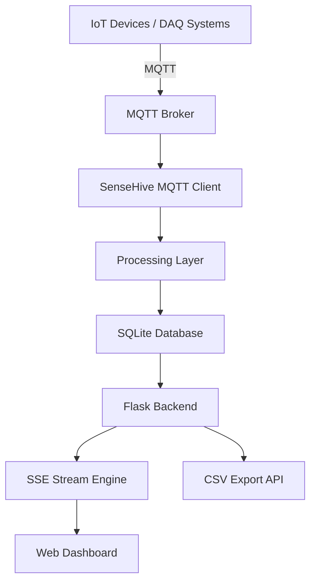

### As part of the EdgeShell system

SenseHive also runs next to [EdgeShell](https://github.com/855princekumar/edgeshell),
the fleet control plane, as its **heartbeat receiver**. Five projects work
together:

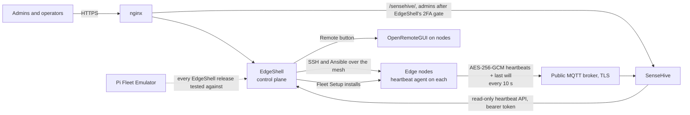

| Part | Job |
| ---- | --- |
| [EdgeShell](https://github.com/855princekumar/edgeshell) | Users, roles, 2FA, SSH and Ansible to nodes, monitoring, uptime and SLA |
| **SenseHive** | Verifies node heartbeats and serves their state to EdgeShell; MQTT data logger for admins |
| [MQTT heartbeat agent](https://github.com/855princekumar/mqtt-heartbeat-service) | On every node: encrypted heartbeat every 10 s and a last will |
| [OpenRemoteGUI](https://github.com/855princekumar/OpenRemoteGUI) | Browser remote desktop on nodes |
| [Pi Fleet Emulator](https://github.com/855princekumar/pi-fleet-emulator) | Emulated Pi fleet for testing |

**Recommended setup:** run SenseHive from EdgeShell's Compose file (it is
already in it), give both the same `HEARTBEAT_MASTER_KEY` and API token, install
the agent from EdgeShell's **Fleet Setup**, and open SenseHive from EdgeShell's
admin panel. Node status then arrives on two independent paths: SSH metrics
over the mesh, and heartbeats over the broker, so a VPN outage is told apart
from a node outage. Details: [docs/HEARTBEAT.md](docs/HEARTBEAT.md).

---

## Data Flow

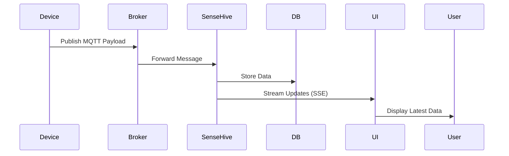
---

## Folder Structure

```
.
├── version-1.0/              # application (also the `sensehive` pip package)
│   ├── app.py                # Flask app + MQTT logger
│   ├── cli.py                # `sensehive` command
│   ├── heartbeat.py          # heartbeat receiver + read-only API
│   ├── security.py           # sign-in hardening
│   ├── templates/            # dashboard, login and heartbeats pages
│   ├── static/               # built browser code (committed, no CDN)
│   ├── requirements.txt
│   └── Dockerfile
├── frontend/                 # browser sources (JSX, CSS), built by `npm run build`
├── tools/                    # front-end build, browser UI test, screenshots
├── tests/                    # regression suite (pytest) + legacy DB fixture
├── docs/                     # guides and architecture decision records
├── .github/workflows/        # CI (every PR) and CD (Docker Hub, PyPI, releases)
├── Docker-compose/           # compose files for x86 and ARM
├── Test-sensehive/           # test publisher script
├── pyproject.toml            # pip packaging (sensehive-iot)
├── DOCKERHUB.md              # Docker Hub description (synced by CD)
├── README.md
└── LICENSE
```

The Home Assistant add-on lives in its own repository:
[855princekumar/sensehive-ha-addon](https://github.com/855princekumar/sensehive-ha-addon).

---

## Deployment

### Option 1: Docker (Recommended)

#### Pull Images

```bash
docker pull devprincekumar/sense-hive:latest
```

* One multi-arch image for AMD64 / x86 and ARM64 (Raspberry Pi 4/5); Docker picks the right one
* Pin a release with `devprincekumar/sense-hive:1.4.2`; `edge` tracks the `main` branch
* `arm-pi-5` remains available and points to the same multi-arch release

---

#### Run Container

```bash
docker run -d \
  -p 5000:5000 \
  -v $(pwd)/data:/app/data \
  devprincekumar/sense-hive:latest
```

---

### Option 2: Docker Compose

Use the provided compose files:

* `docker-compose-amd.yml`
* `docker-compose-arm.yml`

---

### Option 3: Local Run (Without Docker)

```bash
cd version-1.0
python app.py
```

Access the dashboard:

```
http://localhost:5000
```

---

### Option 4: pip install (CLI)

```bash
pip install sensehive-iot
sensehive --port 5000
```

Options:

```bash
sensehive --host 0.0.0.0 --port 5000 --broker broker.hivemq.com
sensehive --broker 192.168.1.10 --broker-port 1883 --broker-username user --broker-password pass
sensehive --timezone Asia/Kolkata --data-dir ~/sensehive-data
sensehive --version
```

Data is stored in `~/.sensehive` unless `--data-dir` (or `DB_PATH`) is set. `--broker` overrides
the broker saved in Settings. Install straight from GitHub with
`pip install git+https://github.com/855princekumar/sense-hive`.

---

## Home Assistant Add-on (HAOS)

One-click deployment for Home Assistant OS / Supervised users.

[](https://my.home-assistant.io/redirect/supervisor_add_addon_repository/?repository_url=https%3A%2F%2Fgithub.com%2F855princekumar%2Fsensehive-ha-addon)

1. **Settings → Add-ons → Add-on Store → ⋮ → Repositories**, add `https://github.com/855princekumar/sensehive-ha-addon`
2. Install **SenseHive**, press **Start**, enable **Show in sidebar**
3. Open **SenseHive** from the sidebar, add a topic and publish

| Feature | Details |
| ------- | ------- |
| Ingress | Opens in the Home Assistant sidebar; Home Assistant handles authentication |
| Zero MQTT setup | Connects to the Mosquitto broker add-on automatically (or set a broker in Configuration) |
| Backups | Database stored in the add-on `/data` folder, included in Home Assistant backups |
| Security | AppArmor profile, no privileges, direct port access disabled by default |
| Architectures | amd64 and aarch64 (Raspberry Pi 4/5) |

**Build, test and validation**

| Check | Result |
| ----- | ------ |
| Home Assistant app linter (official schema) | Passed |
| AppArmor profile parse (`apparmor_parser`) | Passed |
| Multi-arch image build (amd64 + aarch64) | Passed, published as `devprincekumar/sense-hive:1.3.0` |
| Sandbox: mock Supervisor at 172.30.32.2 + Mosquitto with credentials + ingress proxy | 26/26 checks passed |
| Real Home Assistant: official apps devcontainer, Home Assistant 2026.10.1 + Supervisor 2026.10.2 (store install, Mosquitto discovery, ingress via Core, data flow, LWT, restart, backup) | 21/21 checks passed |
| Supervisor security rating | 8/8 (AppArmor profile, no API or host access, protected mode) |

The add-on repository runs the linter, AppArmor, build and sandbox checks on every change,
and a daily sync workflow opens a PR when a new SenseHive release is published.

---

### Alternative: Docker next to Home Assistant

SenseHive can also run as a plain container next to Home Assistant, connected to the same MQTT broker (e.g., Mosquitto add-on).

This setup is useful for:

- Inspecting raw MQTT topics  
- Logging data independently of Home Assistant  
- Exporting MQTT data for analysis  

---

### Quick Setup (Docker Compose)

#### Standard Systems (x86 / AMD64)

```yaml
version: "3.8"

services:
  sense-hive:
    image: devprincekumar/sense-hive:latest
    container_name: sense-hive
    ports:
      - "5500:5000"
    volumes:
      - ./sensehive-data:/app/data
    restart: unless-stopped
    networks:
      - sense-hive-network
    healthcheck:
      test: ["CMD", "python", "-c", "import urllib.request; urllib.request.urlopen('http://localhost:5000/api/status')"]
      interval: 30s
      timeout: 10s
      retries: 3
      start_period: 10s

networks:
  sense-hive-network:
    driver: bridge
```

Access SenseHive at: http://localhost:5500  

---

#### Raspberry Pi (ARM)

```yaml
version: "3.8"

services:
  sense-hive:
    image: devprincekumar/sense-hive:arm-pi-5
    container_name: sense-hive
    ports:
      - "5500:5000"
    volumes:
      - /config/sensehive:/app/data
    restart: unless-stopped
    networks:
      - sense-hive-network
    healthcheck:
      test: ["CMD", "python", "-c", "import urllib.request; urllib.request.urlopen('http://localhost:5000/api/status')"]
      interval: 30s
      timeout: 10s
      retries: 3
      start_period: 10s

networks:
  sense-hive-network:
    driver: bridge
```

Access SenseHive at: http://localhost:5500  

---

### Notes for Home Assistant Users

* Use the same MQTT broker configured in Home Assistant (typically Mosquitto)

* Broker host is usually:

  * `homeassistant.local`
  * or the Home Assistant IP (e.g., `192.168.1.x`)

* Default MQTT port: `1883`

* Use the same credentials defined in Home Assistant

---

### Data Persistence

* For standard Docker setups:

  * `./sensehive-data:/app/data`

* For Home Assistant environments:

  * `/config/sensehive:/app/data`

This ensures data persists across container restarts and aligns with Home Assistant storage conventions.

---

## Default Access

```
Username: admin
Password: SENSEHIVE_ADMIN_PASSWORD from the first start, otherwise admin123
```

Change `admin123` straight after the first sign-in. The sign-in page never shows
it, and five wrong passwords lock sign-in for 15 minutes.

---

## Data Persistence

Database location:

```
/app/data/iot_dashboard.db
```

| Install | Database location |
| ------- | ----------------- |
| Docker | `/app/data/iot_dashboard.db` (mount a volume) |
| Home Assistant add-on | `/data/iot_dashboard.db` (included in backups) |
| pip | `~/.sensehive/iot_dashboard.db` (or `--data-dir`) |

Note:

* Without volume mounting, data will not persist across container restarts
* SQLite runs in WAL mode; `-wal`/`-shm` files next to the database are normal

## Configuration

The default setup uses a public MQTT broker for quick testing.

You can modify:
- MQTT broker (local or remote)
- Credentials
- Timezone settings

Most settings live in the UI (**Settings**): broker, credentials, timezone, data retention and password.
Environment variables set the defaults for a new database:

| Variable | Default | Purpose |
| -------- | ------- | ------- |
| `DEFAULT_BROKER_HOST` / `DEFAULT_BROKER_PORT` | `broker.hivemq.com` / `1883` | Broker for a new database |
| `DEFAULT_BROKER_USERNAME` / `DEFAULT_BROKER_PASSWORD` | empty | Broker credentials |
| `SENSEHIVE_FORCE_BROKER` | `false` | `true` applies `DEFAULT_BROKER_*` on every start |
| `DEFAULT_TIMEZONE` | `UTC` | Timezone for a new database |
| `RETENTION_DAYS` / `RETENTION_MAX_ENTRIES` | `0` (off) | Initial retention policy |
| `RETENTION_INTERVAL` | `3600` | Seconds between retention runs |
| `SQLITE_WAL` | `true` | Set `false` on network filesystems (NFS/SMB) |
| `SECRET_KEY` | random, persisted next to the DB | Session secret |
| `DB_PATH` | `/app/data/iot_dashboard.db` | Database location |
| `HOST` / `PORT` | `0.0.0.0` / `5000` | Listen address for `python app.py` |
| `HEARTBEAT_*` | off | Heartbeat receiver, see [Heartbeat receiver](#heartbeat-receiver-v12) |
| `SENSEHIVE_ADMIN_PASSWORD` | empty (`admin123`) | First password of the `admin` user in a new database (never printed) |
| `SENSEHIVE_MAX_FAILED_LOGINS` / `SENSEHIVE_LOCK_MINUTES` | `5` / `15` | Sign-in is refused for a user or an address after this many failures in this window |
| `SENSEHIVE_TRUST_PROXY` | `false` | Behind a reverse proxy: take the client address from `X-Real-IP` (limits per real client) |
| `SENSEHIVE_COOKIE_SECURE` / `_SAMESITE` / `_PATH` | `false` / `Lax` / `/` | Session cookie flags (always HttpOnly); behind HTTPS use `true` / `Strict` |
| `SENSEHIVE_SESSION_HOURS` | `12` | Session lifetime |

---

## Test Setup (Quick Validation)

A test publisher is included to simulate IoT data.

### Step 1: Start SenseHive

Run using Docker or local execution.

---

### Step 2: Run Test Script

```bash
cd test-sensehive
python test_script.py
```

---

### Step 3: Configure Dashboard

* Add topic: `test-sensehive`
* Observe live updates
* View latest 50 entries
* Export data using CSV

---

## Example Payload

```json
{
  "device_id": "sensehive_node_01",
  "timestamp": 1710000000,
  "temperature": 28.5,
  "humidity": 62,
  "status": "active"
}
```

---

## Testing and CI/CD

Run the suites locally (details in [Development and testing](docs/DEVELOPMENT.md)):

```bash
pip install -r version-1.0/requirements.txt pytest
python -m pytest                                        # unit + API tests
SENSEHIVE_TEST_BROKER=localhost:1883 python -m pytest   # plus end-to-end against a real broker
pip install playwright && python -m playwright install chromium
python tools/ui_test.py                                 # browser UI: every screen size and zoom
npm ci && npm run check                                 # built front end matches its sources
```

| Pipeline | Trigger | What runs |
| -------- | ------- | --------- |
| CI | Every pull request and push to `main` | Regression tests on Python 3.9 to 3.13 against a real Mosquitto broker, paho-mqtt 1.x compatibility, browser UI test (phone to desktop, 67 to 200 % zoom, CSP violations), ruff, Bandit, pip-audit, front-end build check, CodeQL, wheel build + CLI smoke test, Docker build + container health check |
| CD | Push to `main` | Full CI, then publishes `devprincekumar/sense-hive:edge` (amd64 + arm64) |
| CD | Tag `vX.Y.Z` | Full CI, then publishes `X.Y.Z`, `X.Y`, `latest`, `arm-pi-5`, updates the Docker Hub description, publishes `sensehive-iot` to PyPI and creates a GitHub release |

---

## Performance Benchmarks

Based on internal LAN testing with Docker deployment.
Tested on: Raspberry Pi 5 (8GB) and x86 local system

| Metric                | Value / Range              |
|---------------------|---------------------------|
| Ingestion Rate       | ~1k–3k msgs/min           |
| Devices Supported    | ~20–50 devices            |
| CPU Usage            | ~5–15% (Raspberry Pi 5)   |
| Memory Usage         | ~80–150 MB                |
| Dashboard Latency    | <1 second                 |

> Note: Values are indicative and may vary depending on workload and hardware.

---

## Comparison with Existing Solutions

| Feature / Tool       | SenseHive           | ThingsBoard    | Node-RED        | Grafana + MQTT | Home Assistant |
| -------------------- | ------------------- | -------------- | --------------- | -------------- | -------------- |
| Setup Complexity     | Very Low            | High           | Medium          | High           | Medium         |
| One-Click Deployment | Yes                 | No             | Partial         | No             | Partial        |
| Resource Usage       | Low                 | High           | Medium          | High           | Medium         |
| MQTT Native Support  | Yes                 | Yes            | Yes             | Plugin-based   | Yes            |
| Built-in Storage     | Yes                 | Yes            | No              | No             | Yes            |
| Real-Time Dashboard  | Yes                 | Yes            | Limited         | Yes            | Yes            |
| Data Export          | Yes                 | Yes            | Custom          | Yes            | Limited        |
| Edge Device Friendly | Yes                 | Limited        | Yes             | Limited        | Limited        |
| Learning Curve       | Low                 | High           | Medium          | High           | Medium         |
| Intended Use Case    | Lightweight logging | Enterprise IoT | Flow automation | Observability  | Smart home     |

---

## Positioning

SenseHive is designed as:

> A lightweight, plug-and-play MQTT data logger and dashboard for quick deployment and internal use.

It is not intended to replace full-scale IoT platforms.

---

## When to Use SenseHive

- You need quick MQTT data logging without heavy setup  
- You are working with edge devices (ESP32, Raspberry Pi, DAQ systems)  
- You want a self-hosted, lightweight dashboard  
- You need fast prototyping or internal monitoring  

---

## When NOT to Use SenseHive

- You need large-scale distributed IoT infrastructure  
- You require multi-tenant SaaS architecture  
- You need advanced analytics or big data pipelines  
- You expect enterprise-grade scalability out of the box

---

## Current Limitations

* SQLite may not scale for high-throughput systems
* Table-per-topic schema limits scalability
* No dynamic schema optimization
* No built-in migration to time-series databases
* Basic authentication system
* No alerting or automation engine

---

## Versioning and Release Status

### v1.4 (Current)

* EdgeShell's theme, responsive layout at every screen size and zoom, no CDN with a strict CSP, SQL-safe topic names, browser UI test, full docs and ADRs ([What's New in v1.4](#whats-new-in-v14))

### v1.3

* Sign-in hardening: salted, slow password hashes (old ones upgraded on the next sign-in), lockout after repeated failures per user and per address, a new session on every sign-in, cross-site requests that change data refused, HttpOnly cookies with configurable SameSite, Secure and Path, optional first admin password from the environment

### v1.2

* Heartbeat receiver: encrypted, authenticated heartbeats and LWT from edge nodes over a public broker, `/heartbeats` page, read-only API ([Heartbeat receiver](#heartbeat-receiver-v12))

### v1.1

* SQLite WAL mode and data retention
* Topic stats, tags, node grouping and LWT device status
* JSON payload wrapping fix, wildcard topic logging, multi-tab live updates
* pip package with CLI, Home Assistant add-on with ingress
* Regression suite and CI/CD; multi-arch Docker image

See [What's New in v1.1](#whats-new-in-v11).

---

### v1.0

* Stable and tested
* Running in internal LAN environments
* Used for real data aggregation across multiple devices
* Verified over more than two months of continuous usage

---

### Planned

* Alerts and notifications
* Advanced filters and tag analytics
* Node-level analytics
* Schema optimization groundwork

---

## Stability Statement

SenseHive is:

* Reliable for self-hosted and LAN-based deployments
* Suitable for continuous MQTT data logging
* Actively used in internal setups

However, it is still under development toward a fully scalable production-grade platform.

---

## Community Release

This project is being released as open source to:

* Enable wider testing
* Gather feedback from real-world use cases
* Improve scalability and feature set

Contributions, suggestions, and improvements are encouraged.

---

## License

MIT License

---

## Closing Note

SenseHive is built to simplify MQTT-based data logging and visualization without introducing unnecessary complexity.

It is particularly suited for:

* Edge deployments
* Rapid prototyping
* Internal monitoring systems
* Lightweight IoT infrastructures

The focus remains on usability, portability, and practical engineering needs.

---

## Support & Feedback

If you find this useful, consider starring the repository.

Feedback, issues, and contributions are welcome to help improve the project.
