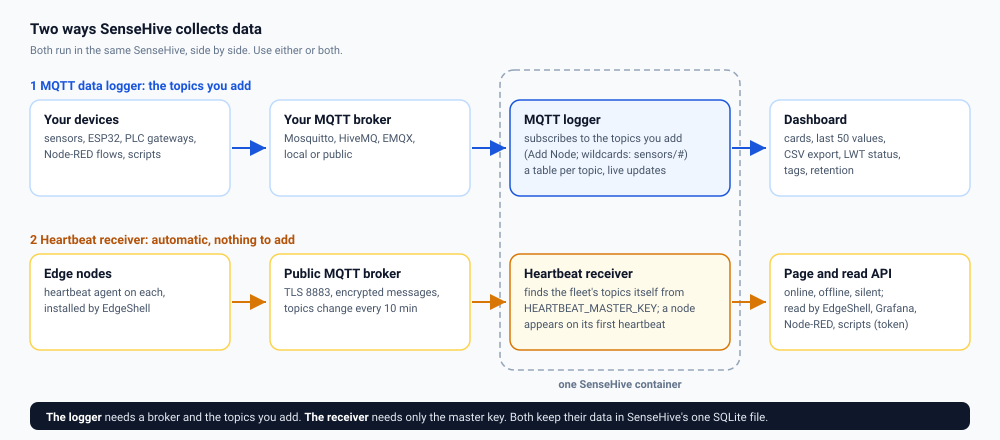
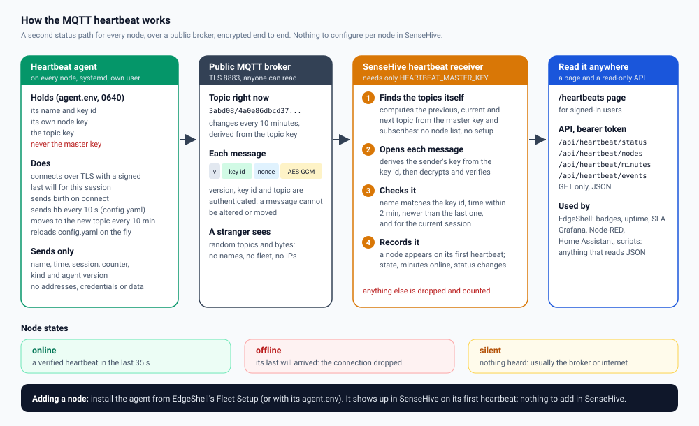
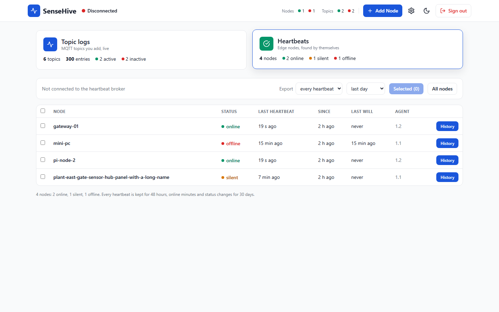
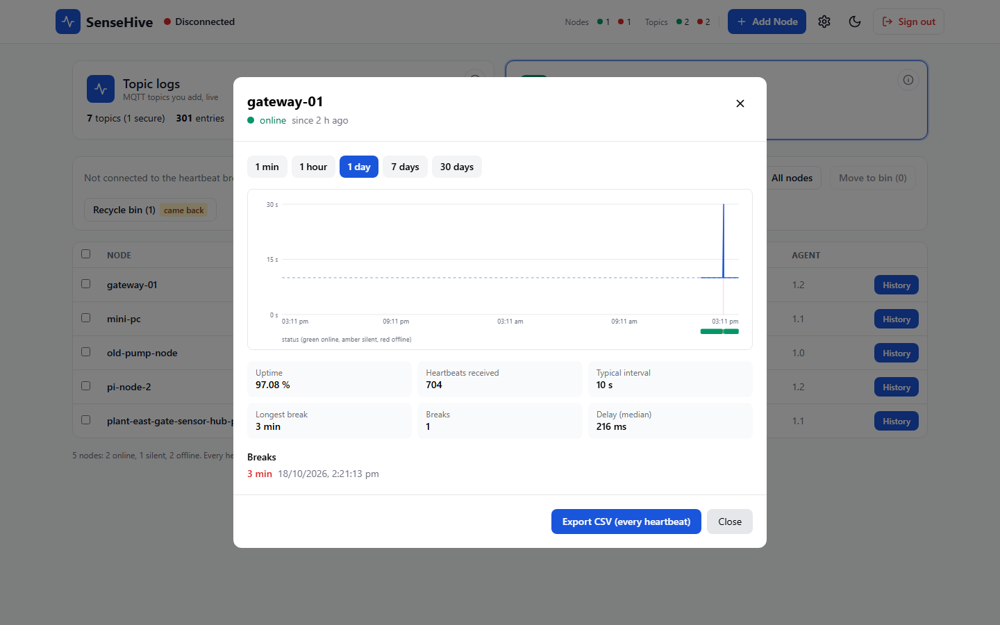
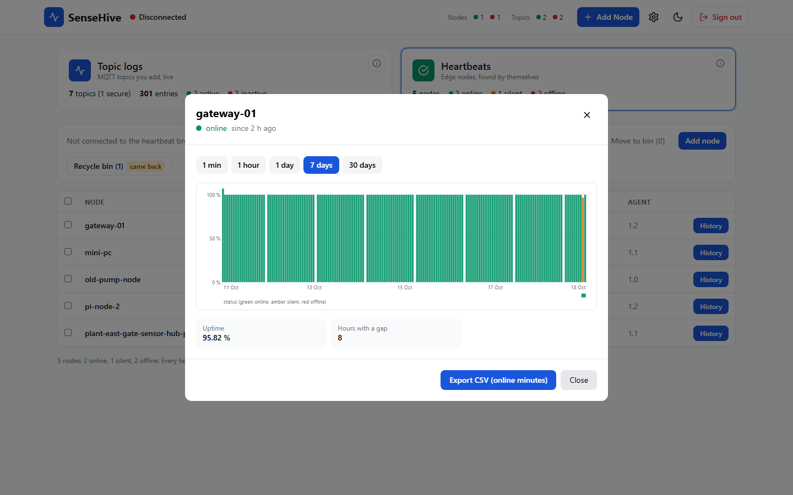

# Heartbeats, the read API and EdgeShell

SenseHive does two jobs, side by side, in one container:



1. **MQTT data logger** (the classic SenseHive): point it at your broker, **Add
   Node** for each topic (wildcards work), and watch the values on the
   dashboard, with history, CSV export and LWT status. See
   [Using SenseHive](USING.md).
2. **Heartbeat receiver** (since 1.2): edge nodes running the
   [MQTT heartbeat agent](https://github.com/855princekumar/mqtt-heartbeat-service)
   send encrypted heartbeats over a **public** broker. SenseHive finds them by
   itself, shows them on the **Heartbeats** page and serves them through a
   **read-only API** that EdgeShell, Grafana, Node-RED, Home Assistant or a
   script can read.

The two are independent: the logger uses the broker and topics you set in
**Settings**; the receiver uses its own TLS connection to the heartbeat broker
and its own tables. Turning one on or off never affects the other.

## Contents

1. [How the heartbeat works](#how-the-heartbeat-works)
2. [What the agent does on a node](#what-the-agent-does-on-a-node)
3. [How SenseHive finds nodes by itself](#how-sensehive-finds-nodes-by-itself)
4. [Node states](#node-states)
5. [Heartbeat history, charts and CSV export](#heartbeat-history-charts-and-csv-export)
6. [Turning the receiver on](#turning-the-receiver-on)
7. [The read API](#the-read-api)
8. [Reading heartbeats from other tools](#reading-heartbeats-from-other-tools)
9. [With EdgeShell](#with-edgeshell)
10. [Security](#security)
11. [Troubleshooting](#troubleshooting)

## How the heartbeat works



One 32-byte **master key** defines a fleet. Everything else is derived from it
(the code is `heartbeat_protocol.py`, the same file in the agent, SenseHive and
EdgeShell, pinned by shared test vectors):

| Derived value | How | Who holds it |
| ------------- | --- | ------------ |
| Key id of a node | `HMAC(master, "kid|" + name)`, 8 bytes | the node, in the clear in every message |
| Node key | `HMAC(master, "node|" + key id)` | that node only |
| Topic key | `HMAC(master, "topic")` | every node; only lets it compute topics |
| Topic | `HMAC(topic key, window)`, two random-looking levels | changes every 10 minutes |
| Master key | 32 random bytes | **SenseHive and EdgeShell only, never a node** |

## What the agent does on a node

The agent lives in `/opt/edgeshell-heartbeat` and runs under systemd as its own
unprivileged user (or as a background process where there is no systemd).

1. **Starts** with its identity from `agent.env` (name, key id, node key, topic
   key; mode 0640) and its settings from `config.yaml` (broker, port, TLS,
   interval; no secrets).
2. **Connects** to the broker over TLS (certificate verified) with a random
   client id, and registers a **last will**: an encrypted `lwt` message that
   the *broker* publishes if the agent's connection drops. The will carries
   the session (the connect time).
3. **Sends `birth`** as soon as the connection is up.
4. **Sends `hb` every `interval` seconds** (10 by default), each with the time
   and a counter.
5. **Moves to the next topic** when the 10-minute window changes: it
   reconnects with a fresh last will on the new topic.
6. **Reloads `config.yaml`** on the fly: change the broker or interval on
   every node at once (EdgeShell pushes it), no restart.

Every message is `version | key id | nonce | AES-256-GCM ciphertext`. The
ciphertext holds only `{name, kind, time, session, counter, agent version}`:
no addresses, credentials, metrics or sensor data. The version, key id and
topic are authenticated, so a message cannot be altered or moved to another
topic or node.

## How SenseHive finds nodes by itself

There is **no list of nodes in SenseHive** and nothing to add per node:

1. From the master key, SenseHive computes the **previous, current and next**
   topics (allowing for clock drift and late wills), subscribes to them, and
   moves along as the windows change.
2. For each message it reads the **key id** from the header, **derives that
   node's key** from the master key, and decrypts. Only a node provisioned from
   the same master key can produce a message that decrypts.
3. It checks that the **name inside matches the key id**, that the time is
   within 2 minutes, newer than the node's last message, and (for a will) that
   it belongs to the current session.
4. The node is **recorded on its first valid heartbeat**: name, state, agent
   version, the minutes it was online, and every change of state.

Anything else on the broker (other people's traffic, replays, forgeries,
messages for another fleet) is dropped silently and counted in `rejected`.

So adding a node is only: provision it (EdgeShell's **Fleet Setup** does it, or
generate its `agent.env`) and install the agent. It appears on the Heartbeats
page within seconds.

## Node states

| State | Meaning | Typical cause |
| ----- | ------- | ------------- |
| `online` | A verified heartbeat in the last `HEARTBEAT_STALE_SECONDS` (35) | the node is up |
| `offline` | Its last will arrived for the current session | the node lost power or network, or the agent stopped |
| `silent` | No heartbeat and no will | the broker or the internet path, not the node |

Each change is stored as an event; the minutes with a heartbeat are stored for
`HEARTBEAT_KEEP_DAYS` (30) to measure uptime exactly.

## Heartbeat history, charts and CSV export

Open the dashboard and choose the **Heartbeats** card. Every node the receiver
has seen is listed with its status, last heartbeat, how long it has been in that
state, its last will and its agent version.



**History** on a node opens its chart for the last **1 minute, 1 hour, 1 day,
7 days or 30 days**:

| Period | Chart | From |
| ------ | ----- | ---- |
| 1 minute, 1 hour, 1 day | seconds between consecutive heartbeats; breaks shaded red, last wills as red lines, the usual interval dashed | every heartbeat (kept `HEARTBEAT_BEATS_HOURS`, 48) |
| 7 days, 30 days | uptime per hour (green 99 % or more, amber 50 % or more, red below) | online minutes (kept `HEARTBEAT_KEEP_DAYS`, 30) |

Under the chart: uptime, heartbeats received, the usual interval, the longest
break, the number of breaks, the median delivery delay, and a list of breaks
with their times. A **break** is a gap longer than 2.5 times the usual interval
(at least 5 seconds more), so a 10-second node shows any silence over 25
seconds. The status band under the chart shows online, silent and offline
periods.

A node that is **offline or silent now** always shows its outage on every
period, in red above the figures: how long it has been down since its last
heartbeat, and when its last will arrived. That holds also when the last
heartbeat is older than the chosen period, or older than the kept heartbeats
(a node that went down before heartbeat history existed). With fewer than two
heartbeats to measure, the agent's 10-second interval is assumed. A last will
inside an outage does not split it: the break runs from the last heartbeat to
the next one.





**CSV export**

- In the history: **Export CSV** for that node and period.
- In the list: tick nodes (or the box in the header for all), choose **every
  heartbeat**, **online minutes** or **status changes** and a period, then
  **Selected** or **All nodes**. One file holds all the chosen nodes, with a
  `node` column.

| Export | Columns |
| ------ | ------- |
| every heartbeat | `node, time_utc, unix_time, kind (birth, hb, lwt), delay_ms` |
| online minutes | `node, minute_utc, unix_time` |
| status changes | `node, time_utc, unix_time, status` |

Cells that a spreadsheet could run as a formula are escaped (see
[Security](SECURITY.md#exports)).

## Turning the receiver on

```bash
# .env next to docker-compose.yml (never commit it)
HEARTBEAT_MASTER_KEY=<64 hex characters>     # python -c "import secrets; print(secrets.token_hex(32))"
HEARTBEAT_API_TOKEN=<32+ characters>          # python -c "import secrets; print(secrets.token_urlsafe(32))"
# optional, these are the defaults
HEARTBEAT_BROKER=broker.hivemq.com
HEARTBEAT_PORT=8883
HEARTBEAT_TLS=true
```

Restart SenseHive. The log says `Heartbeat receiver on`, and the **Heartbeats**
page says `connected to the heartbeat broker`. The MQTT logger keeps working
exactly as before.

## The read API

`GET` only. Authenticate with `Authorization: Bearer <HEARTBEAT_API_TOKEN>`
(for tools) or a signed-in browser session. Times are Unix seconds.

### `GET /api/heartbeat/status`

```json
{"enabled": true, "connected": true, "rejected": 12, "nodes": 4}
```

`rejected` counts messages dropped as not authentic, stale or replayed.

### `GET /api/heartbeat/nodes`

```json
{
  "enabled": true,
  "connected": true,
  "nodes": [
    {"name": "pi-node-01", "status": "online", "last_seen": 1760610012.4,
     "since": 1760541203.0, "lwt_at": null, "agent_version": "1.1.0"},
    {"name": "gateway-02", "status": "offline", "last_seen": 1760609100.9,
     "since": 1760609130.2, "lwt_at": 1760609130.2, "agent_version": "1.1.0"}
  ]
}
```

`since` is when the node entered its current state; `lwt_at` is when its last
will arrived.

### `GET /api/heartbeat/minutes?since=<unix>`

```json
{"since": 1760606400, "minutes": {"pi-node-01": [1760606400, 1760606460, 1760606520]}}
```

The start of every minute in which each node sent a verified heartbeat (at
most `HEARTBEAT_KEEP_DAYS` back). Uptime over a period is the number of minutes
listed divided by the minutes in the period.

### `GET /api/heartbeat/history?node=<name>&range=<1m|1h|1d|7d|30d>`

The data behind the history chart for one node:

```json
{"node": "pi-node-01", "range": "1h", "since": 1760606412.0, "until": 1760610012.0,
 "kind": "beats", "points": [[1760606415.2, 1, 0.21], [1760606425.2, 1, 0.19]],
 "interval": 10.0, "received": 352, "lag_ms": 210, "longest_break": 180.0,
 "breaks": [{"from": 1760608000.1, "to": 1760608180.3, "seconds": 180.2, "lwt_at": 1760608031.4}],
 "current_break": null,
 "events": [{"status": "online", "at": 1760541203.0}], "uptime": 95.0}
```

`points` are `[receive time, kind (0 birth, 1 heartbeat, 2 last will), delay
in seconds]`. For `7d` and `30d`, `kind` is `"hours"` and `points` are
`[hour start, online minutes, minutes in range]`. `current_break` (every
period) is the outage still going on, or `null`: `{"from": <last heartbeat>,
"to": null, "seconds": ..., "status": "offline" | "silent", "lwt_at": ...}`;
`from` may be before `since`. For `1m` to `1d` it is also the last item of
`breaks`. `400` for an unknown range,
`404` for an unknown node.

### `GET /api/heartbeat/export.csv?nodes=<a,b|all>&what=<beats|minutes|events>&since=<unix>&until=<unix>`

The CSV files described above. `nodes` defaults to all, `what` to `beats`,
`since` to one day ago (at most `HEARTBEAT_KEEP_DAYS` back).

### `GET /api/heartbeat/events?since=<unix>`

```json
{"events": [{"id": 41, "name": "gateway-02", "status": "offline", "at": 1760609130.2}]}
```

State changes, oldest first, up to 1000 per call: pass the last `at` you saw
to page forward. Good for alerts.

Errors: `401 {"error": "Authentication required"}` without a valid token or
session. When the receiver is off, `enabled` is `false` and the lists are
empty.

## Reading heartbeats from other tools

**Where to call it.** A stand-alone SenseHive serves the API on its own port
(`http://<host>:5000/api/heartbeat/...`). In the EdgeShell stack SenseHive has
**no published port** and its public path `/sensehive/` is for signed-in
administrators only, so tools call it from inside the stack's network
(`http://sensehive:5000/...`), or you publish it on a private address only,
for example a compose override:

```yaml
services:
  sensehive:
    ports:
      - "127.0.0.1:5001:5000"     # this host only; or your Tailscale IP, never 0.0.0.0
```

**curl**

```bash
curl -s -H "Authorization: Bearer $HEARTBEAT_API_TOKEN" http://localhost:5000/api/heartbeat/nodes
```

**Python**

```python
import os, requests
r = requests.get('http://localhost:5000/api/heartbeat/nodes',
                 headers={'Authorization': f"Bearer {os.environ['HEARTBEAT_API_TOKEN']}"}, timeout=5)
down = [n['name'] for n in r.json()['nodes'] if n['status'] != 'online']
print('not online:', down or 'none')
```

**Node-RED:** an *inject* node every 30 s, then an *http request* node (GET,
return a parsed JSON object, header `Authorization: Bearer <token>`), then a
*split* on `msg.payload.nodes` and a *switch* on `msg.payload.status`.

**Home Assistant** (`configuration.yaml`):

```yaml
rest:
  - resource: http://sensehive.local:5000/api/heartbeat/nodes
    headers:
      Authorization: !secret sensehive_heartbeat_token
    scan_interval: 30
    sensor:
      - name: Edge nodes online
        value_template: "{{ value_json.nodes | selectattr('status', 'eq', 'online') | list | count }}"
```

**Grafana:** the *Infinity* data source, URL
`/api/heartbeat/nodes`, root selector `nodes`, with the bearer token as a
header; or `/api/heartbeat/minutes` for uptime panels.

Keep the token in the tool's secret store, not in a dashboard JSON or a flow
you share.

## With EdgeShell

EdgeShell runs SenseHive in its Compose stack and:

- gives it the master key and API token from its own `.env`
  (`HEARTBEAT_MASTER_KEY`, `SENSEHIVE_API_TOKEN`);
- installs and updates the agent from **Fleet Setup**, giving every node only
  its own `agent.env`;
- polls the API and shows heartbeat badges, uptime and SLA on its node cards;
  a node counts as up when SSH reaches it **or** a verified heartbeat arrived;
- links administrators to SenseHive at `/sensehive/` behind its sign-in and a
  fresh 2FA code. SenseHive keeps its own password and lockout on top.

## Security

| Threat | Protection |
| ------ | ---------- |
| Reading what nodes say on a public broker | AES-256-GCM; the plaintext is only name, time, counter, kind, version |
| Finding or following the fleet | Topics look random and change every 10 minutes; random client ids |
| Faking a node | Each node has its own key; a stolen node key speaks only for that node |
| Replays and old wills | Time within 2 minutes, strictly increasing; wills bound to the session |
| Reading the API | Bearer token (32+ characters, compared in constant time) or a signed-in session; GET only; 20 wrong tokens from one address in 15 minutes lock that address out |
| A stolen node key flooding | Heartbeats closer than `HEARTBEAT_MIN_SPACING` (2 s) are dropped and counted (`flooded` in `/api/heartbeat/status`), so the history and the CPU stay safe |
| Spreadsheet formulas in exports | Cells starting with `=`, `+`, `-`, `@` are escaped; plain numbers stay numbers |
| The master key | Only in SenseHive's and EdgeShell's environment, never on a node, never in the repository |

## Troubleshooting

| Symptom | Check |
| ------- | ----- |
| Page says `receiver off` | `HEARTBEAT_MASTER_KEY` is not set or not 64 hex characters |
| `not connected to the heartbeat broker` | outbound TCP 8883 from SenseHive; `HEARTBEAT_BROKER` |
| A node never appears | on the node: `systemctl status edgeshell-heartbeat` and `journalctl -u edgeshell-heartbeat`; its clock (NTP); it was provisioned with the same master key |
| `rejected` keeps growing | someone else's traffic (normal on a public broker), or a node with a wrong key or a wrong clock |
| API answers 401 | the token is missing, shorter than 32 characters, or different from `HEARTBEAT_API_TOKEN` |
