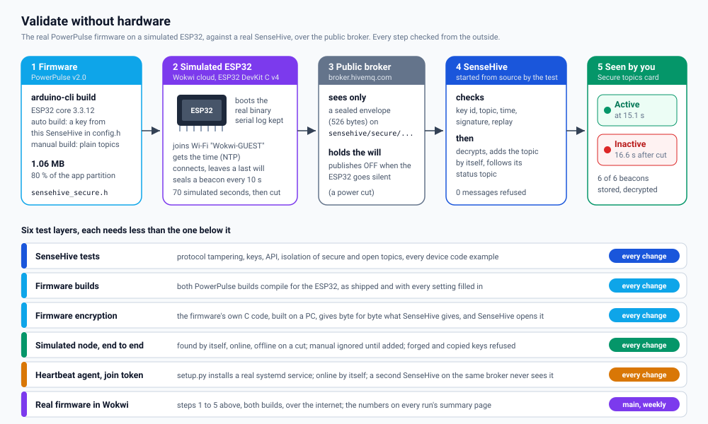

# Validate without hardware

Test the whole chain, **device firmware to broker to SenseHive to dashboard**,
before a single board is flashed or installed on site. Every SenseHive change
already goes through these checks in CI; this guide shows what they prove, the
numbers they measured, and how to run the same checks yourself for your own
setup.

The recommended order for a new deployment:

1. **Simulate** the device and the server together (this guide) until every
   check passes for your broker and your settings.
2. **Flash one real board** with the same settings, watch it appear, pull its
   plug, watch it go offline.
3. **Roll out** the rest.

## Contents

- [The device projects](#the-device-projects)
- [The test layers](#the-test-layers)
- [Measured in the simulation](#measured-in-the-simulation)
- [Run it yourself](#run-it-yourself)
- [Wokwi: the real firmware on a simulated ESP32](#wokwi-the-real-firmware-on-a-simulated-esp32)
- [Heartbeat agent nodes without hardware](#heartbeat-agent-nodes-without-hardware)
- [What a simulation cannot prove](#what-a-simulation-cannot-prove)

## The device projects

| Project | Device | How SenseHive finds it |
| ------- | ------ | ---------------------- |
| [PowerPulse](https://github.com/855princekumar/powerpulse) | ESP32 power presence beacon | **Auto-discovery build:** sealed messages under `sensehive/secure/...`, found by itself ([Secure topics](SECURE-TOPICS.md)). **Manual build:** plain topics, added with **Add Node** |
| [MQTT heartbeat agent](https://github.com/855princekumar/mqtt-heartbeat-service) | Linux edge nodes | Encrypted heartbeats from a fleet key, found by itself ([Heartbeats](HEARTBEAT.md)) |

## The test layers



Each layer needs less than the one below it, so a failure points at the
cause. The tests: SenseHive's `tests/`, PowerPulse's
[`test/`](https://github.com/855princekumar/powerpulse/tree/main/test) and the
heartbeat agent's [`tests/`](https://github.com/855princekumar/mqtt-heartbeat-service/tree/main/tests).

## Measured in the simulation


Measured by CI on 2026-10-18 with the real
[PowerPulse](https://github.com/855princekumar/powerpulse) firmware. Every
run prints the same numbers (`PP-STATS`) and shows them on its summary page in
GitHub Actions. The power cut is real: the simulation stops without a goodbye,
the broker notices within its 15 s keepalive window and publishes the node's
last will, and SenseHive shows it offline.

**The heartbeat agent from a join token**, on a Debian 12 systemd node
(measured on a Windows laptop with Docker Desktop; CI prints its own numbers):
`setup.py` installs in **16 s**; the node shows online **34 s** later (mostly
the agent's Python start in that container); a second SenseHive on the same
broker **never** sees it; a stopped agent shows **silent** after the 35 s
staleness window. The same runs checked that the token never holds the master
key, a cut token installs nothing, the service runs as its own user with
private key and login files, nothing is left in temp folders, and uninstall
removes everything.

## Run it yourself

You need Docker and the two repositories side by side:

```bash
git clone https://github.com/855princekumar/sense-hive
git clone https://github.com/855princekumar/powerpulse
```

**Layers 3 and 4** (no token, no internet beyond package downloads), in a
throwaway Ubuntu container, the same way CI runs them:

```bash
docker run --rm -v "$PWD/powerpulse:/pp:ro" -v "$PWD/sense-hive:/sh:ro" \
  ubuntu:24.04 sh /pp/test/run_local.sh
```

Expected: `13 passed, 2 skipped` (the two skipped are the Wokwi tests).

**Layer 1**, from `sense-hive/`:

```bash
pip install -r version-1.0/requirements.txt pytest
docker run -d --name mq -p 1883:1883 eclipse-mosquitto:1.6
SENSEHIVE_TEST_BROKER=localhost:1883 python -m pytest
```

**Your own settings:** the simulated node reads `PP_TEST_BROKER`
(`host:port`), so point it at your own broker to check that SenseHive and the
devices really meet there before you deploy.

## Wokwi: the real firmware on a simulated ESP32

[Wokwi](https://wokwi.com) simulates an ESP32 with Wi-Fi and internet in the
cloud. The test builds the real PowerPulse firmware with your settings, runs
it there, and checks SenseHive from the outside, exactly as a technician would
see it.

1. **Get a token:** sign in at [wokwi.com](https://wokwi.com), open
   [wokwi.com/dashboard/ci](https://wokwi.com/dashboard/ci) and create a CI
   token. Treat it like a password: never paste it into an issue, a commit or
   a chat, and revoke it there if it leaks.
2. **In GitHub Actions:** add it as the repository secret `WOKWI_CLI_TOKEN`
   (**Settings**, **Secrets and variables**, **Actions**). Workflows read it as
   `${{ secrets.WOKWI_CLI_TOKEN }}`; GitHub masks it in logs and never gives it
   to pull requests from forks. Without it, the job is skipped with a notice.
3. **On your machine** (arduino-cli with the ESP32 core and the PowerPulse
   libraries, and [wokwi-cli](https://github.com/wokwi/wokwi-cli) installed),
   from the folder holding both clones:

   ```bash
   export WOKWI_CLI_TOKEN=...            # from your password manager, not a file in the repo
   export SENSEHIVE_DIR=$PWD/sense-hive/version-1.0 PP_TEST_BROKER=broker.hivemq.com:1883
   pip install -r sense-hive/version-1.0/requirements.txt -r powerpulse/test/requirements.txt
   python -m pytest -v -s powerpulse/test/test_wokwi.py
   ```

   Each build runs for 70 simulated seconds; the run prints a `PP-STATS` line
   with the numbers above. Set `PP_STATS_FILE=stats.jsonl` to keep them.

Simulation minutes are limited on the free plan, which is why SenseHive runs
this layer on `main`, weekly and on demand, and layer 4 on every pull request.

The simulated board is the ESP32 DevKit in
[`test/wokwi/diagram.json`](https://github.com/855princekumar/powerpulse/blob/main/test/wokwi/diagram.json)
of PowerPulse; open the same project at [wokwi.com](https://wokwi.com) to
watch the serial log while you change the firmware.

## Heartbeat agent nodes without hardware

The heartbeat agent is plain Python, so a Linux container with systemd is a
real node:

```bash
docker run -d --name mq -p 1883:1883 eclipse-mosquitto:2 mosquitto -c /mosquitto-no-auth.conf
docker run -d --name node --privileged --cgroupns=host -v /sys/fs/cgroup:/sys/fs/cgroup:rw \
  --add-host host.docker.internal:host-gateway jrei/systemd-debian:12
docker exec node bash -c 'apt-get update -qq && apt-get install -y -qq python3'
git clone https://github.com/855princekumar/mqtt-heartbeat-service
python mqtt-heartbeat-service/tests/join_e2e.py --sensehive-dir sense-hive/version-1.0 --node node \
  --broker 127.0.0.1:1883 --node-broker host.docker.internal:1883
```

It starts two SenseHives with their own fleets, creates a join token in one,
installs the agent on the node with `setup.py`, and checks every step (12
checks, then `E2E-STATS`). Then:

- SenseHive's own tests run the agent's protocol and the join tokens
  (`tests/test_heartbeat*.py`).
- [EdgeShell's sandbox](https://github.com/855princekumar/edgeshell) starts
  SenseHive, a broker and agent nodes in Docker and checks, through the
  production proxy, that heartbeats reach EdgeShell's node cards, that a
  stopped agent's last will shows it offline, and that history and CSV export
  work.
- To try one node by hand: SenseHive with `HEARTBEAT_MASTER_KEY=auto`,
  **Heartbeats, Add node**, then in the container `git clone` the agent and
  `python3 setup.py` with the token, exactly as on a real node.

## What a simulation cannot prove

Validate these on the first real board before rolling out:

- **Radio and power:** Wi-Fi range and signal at the site, brown-outs, the
  power supply. The simulation's Wi-Fi is always perfect.
- **Your network's rules:** whether the site lets the board reach NTP (UDP
  123) and the broker's port.
- **Flashing and the setup portal** on the real board (GPIO27 to GND at boot).
- **Long-run behaviour:** days of uptime, reconnects after router restarts.
  The firmware's watchdog and timed reconnects are built for this, but only
  time on site proves it.
